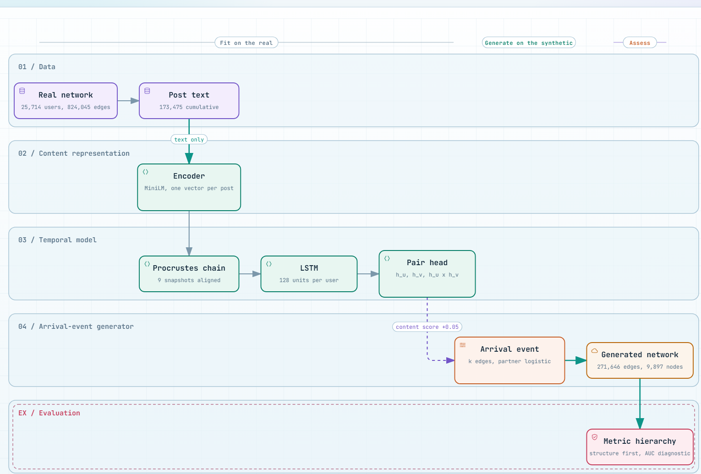

# Reconstructing a social network from post text

This project reconstructs the **link structure** of a population for which only the **text of its posts**
is observed. The mechanism by which an edge is formed is learned from a real social network and applied to
a synthetic population that has no edges and no dates.

The output is not an edge predictor: it is a **generator**. Given the post text and the order in which
users join the platform, it produces a directed network with the same statistical properties as the real
one (degree, reciprocity, transitivity, clustering, modularity) without imposing any of those numbers.



---

## Results in numbers

Last snapshot, real network against the two networks generated by the same pipeline on two temporal
partitions of the synthetic data.

| metric | real | progressive | all-present |
|---|---:|---:|---:|
| users with at least one edge | 25,714 | 9,897 | 9,901 |
| edges | 824,045 | 271,646 | 280,298 |
| mean out-degree | 32.05 | 27.45 | 28.31 |
| maximum out-degree | 1,290 | 274 | 328 |
| reciprocity | 0.4177 | 0.3224 | 0.3035 |
| transitivity | 0.0337 | 0.0212 | 0.0209 |
| mean clustering | 0.0804 | 0.0420 | 0.0435 |
| modularity | 0.2751 | 0.1074 | 0.1030 |
| diameter | 6 | 6 | 6 |
| relative distance from the real | — | **3.84** | 3.90 |

The **progressive** network is the one presented: users enter over time, following the arrival curve
measured on the real data. The **all-present** network, where the whole population exists from the first
step, is the comparison. On the seven comparable metrics the two are equivalent, and reversing the
normalisation reverses the order: the choice is conceptual, not metric. A network that is born must have
arrivals.

On content the result goes against intuition, and this is the most interesting part: the text **identifies**
the user (political leaning is predictable from posts with AUC 0.827, profession with 0.867) but it **does
not decide who links to whom**. The content term weighs +0.05 in the partner-choice model, against +1.22
for "the counterpart is new" and +1.02 for the logarithm of degree. The content homophily that seems to
contradict this reading (2.13 on the real network) falls to 1.29–1.55 once the comparison holds degree
fixed: it is mostly network position.

---

## The pipeline

1. **Content representation.** Each post is encoded individually by a sentence encoder (six compared;
   `all-MiniLM-L6-v2`, per-post encoding) and a user's vectors are averaged into one representation per
   user and snapshot. Text is the only column present on both sides.
2. **Temporal model.** `tNodeEmbed` **without node2vec**: a chain of Procrustes alignments between
   consecutive snapshots, an LSTM over nine steps, a pairwise head on `[h_u, h_v, h_u ⊙ h_v]`. node2vec
   was removed because it initialises itself by observing links, while here every new edge touches a user
   who is arriving: exactly where it would need to see, a structural model is blind.
3. **Arrival-event generator.** The unit is not the pair but **the entering user**: they carry `k` edges
   (a table learned on the real data and rescaled to the population), the direction and the share of
   immediately reciprocated pairs; the partner is chosen by a logistic regression on seven variables
   (degree, degree percentile, novelty, activity, direction, co-occurrence, content score) plus Gumbel
   noise, to sample rather than take the maximum. No threshold and no count is imposed: volume, degrees
   and hubs emerge.
4. **Evaluation.** Network statistics are the primary measure; AUC is diagnostic and lives on the real
   data only, because a generated network has no true edges to predict.

---

## Repository

```
dataset/                          the two datasets and the two generated networks (six folders)
├── real_snapshots/                    real: 9 snapshots, posts and edges
├── synthetic_snapshots/               original synthetic data: 4 native batches
├── synthetic_progressive_posts/       input: posts distributed over 9 steps
├── synthetic_all_present_posts/       same, everyone present from step 1
├── synthetic_progressive/             output: generated edges, embeddings, native batches
└── synthetic_all_present/             same, comparison run
src/
├── paths.py                       paths shared by every script
├── lib/                           data loading, encoders, tNodeEmbed, temporal pipeline
├── pipeline/                      partitions, generation, consolidation
├── analysis/                      structure, temporality, content, homophily, profiles, scorecard
└── figures/                       the figures
results/
├── tables/                        33 CSV files cited by the document
└── figures/                       17 PNG files, all regenerated by src/figures/
document.pdf                       the final document
```

Every data folder exposes the same interface, `snapshot_i/social_network.edg` plus the two post files.
That is why the same analysis code runs on the real network and on the generated ones, without knowing
where the text comes from.

---

## Reproducing the results

Requires [uv](https://docs.astral.sh/uv/) and Python ≥ 3.11. Training runs on CPU.

```bash
uv sync      # environment

# 1. the two partitions of the synthetic data (arrival curve and activity measured on the real)
uv run python -m src.pipeline.build_synthetic_snapshots --activity from-real

# 2. the two networks (authentic text; permuted/off are controls)
uv run python -m src.pipeline.generate_arrival \
    --partition synthetic_progressive_posts --output synthetic_progressive
uv run python -m src.pipeline.generate_arrival \
    --partition synthetic_all_present_posts --output synthetic_all_present

# 3. the analyses, for every folder of interest
uv run python -m src.analysis.analyze_structure  synthetic_progressive
uv run python -m src.analysis.analyze_temporal   synthetic_progressive
uv run python -m src.analysis.analyze_content    synthetic_progressive
uv run python -m src.analysis.analyze_homophily  synthetic_progressive
uv run python -m src.analysis.analyze_profiles   synthetic_progressive

# 4. tables and figures
uv run python -m src.analysis.scorecard
uv run python -m src.analysis.tail_scaling
uv run python -m src.figures.compare_folders
uv run python -m src.figures.plot_partitions
uv run python -m src.figures.plot_homophily_controls
```

All commands run from the project root. The data figures are regenerated by the code; the tables in
`results/tables/` are the output of these scripts.

---

## Things to know about the numbers

- **Not bit-reproducible.** The generator is deterministic (same arrival events, same edges per event),
  but the weights of the trained model vary in the third decimal between processes: a repeat run gives
  271,655 edges instead of 271,646, that is 9 in 271 thousand.
- **The encoder choice is a tie.** MiniLM, GTE-base and BGE-base are within 0.002, below the
  process-to-process variability (~0.005). It should be read as a tie, not a win.
- **The degree tail is steeper than the real one** at matched size: generated hubs are less extreme
  (274 against 1,290). The document measures this with the real network's own scaling law and declares it
  among the limitations.
- **The first step of the progressive partition is emptier than the real one** (15.7% of nodes linked
  against 41.8%). That 41.8% is a pre-existing stock, not a birth step: it is not an error to fix.
- **Distance from the real.** Defined once in `src/analysis/scorecard.py` as
  `|value − real| / |real|`, summed over the seven comparable metrics (density, mean out-degree, maximum
  out-degree, reciprocity, modularity, transitivity, clustering). Edges and nodes are excluded because
  they depend on scale, homophily because every generated network sits at 1.00.

---

## Document

`document.pdf` is the final document, on a CRISP-DM structure: business understanding, data understanding,
data preparation, modelling, evaluation, conclusions. Nine tables, five figures, and the limitations
declared: the figures come from a single execution and carry no confidence intervals.
