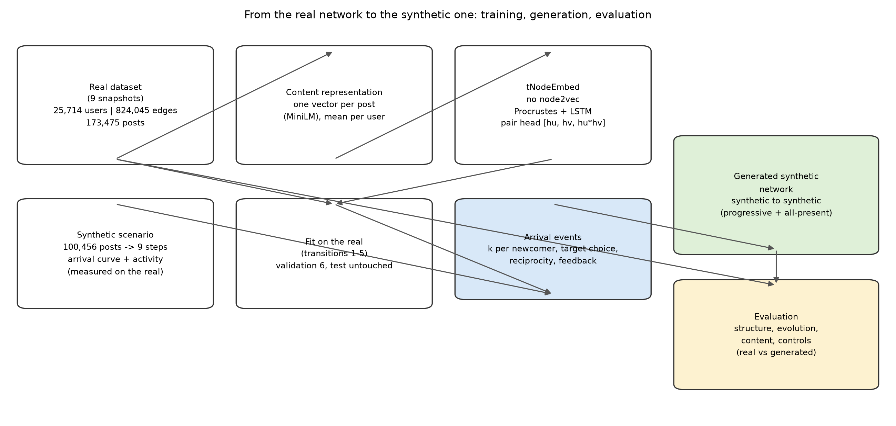
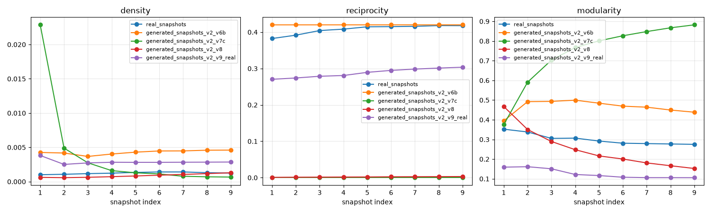
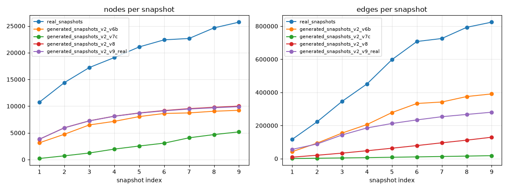
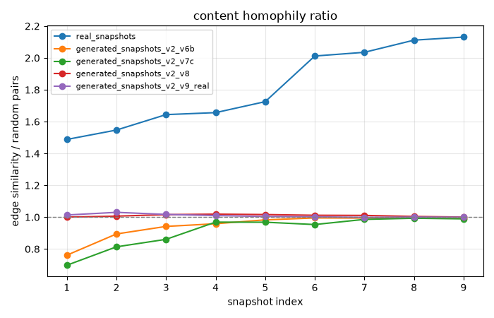
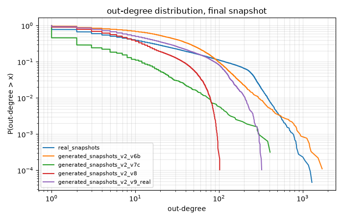
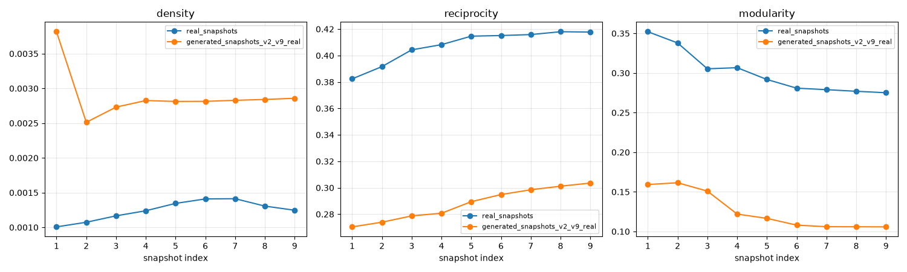
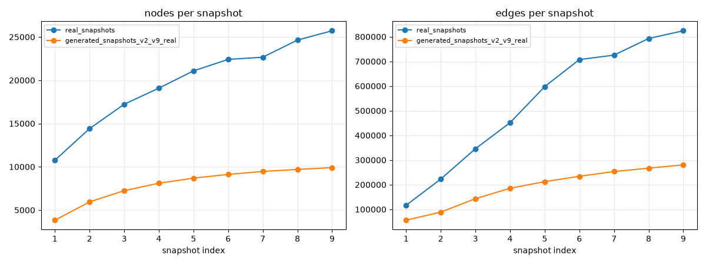
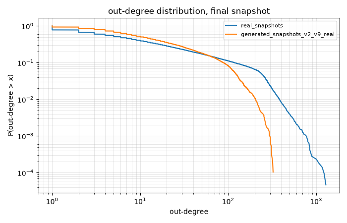
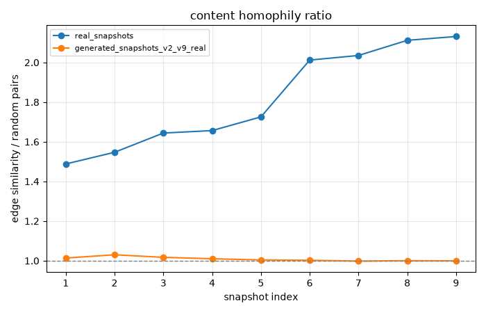
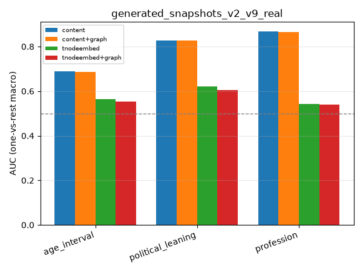

# Dal testo dei post alla rete degli utenti: generazione di una rete sociale temporale per trasferimento di tNodeEmbed

**Angelantonio Fedele Murolo**

*Affiliazione: nessuna.*

---

## Abstract

Costruire la rete di collegamenti di una popolazione di cui si possiede soltanto il testo prodotto — senza alcun collegamento osservato e senza date — richiede di imparare il meccanismo di formazione dei legami da una rete diversa e di applicarlo per inferenza. Questo lavoro studia il problema su due dataset: una rete sociale reale con 25.714 utenti, 824.045 archi diretti e 173.475 post distribuiti su 9 snapshot (2022 – luglio 2025) e un dataset sintetico di 10.002 utenti con 100.456 post, privo di archi e di date, che ripartiamo in 9 passi temporali. L'unica informazione comune ai due dataset è il testo dei post. Il modello temporale è tNodeEmbed nella variante senza node2vec, inizializzata con rappresentazioni del contenuto: le rappresentazioni per snapshot, un allineamento di Procrustes a catena e una LSTM producono un embedding per utente, e una testa di coppia ne stima la probabilità di legame. Poiché la restrizione del protocollo di valutazione originale non ammette alcun arco di test sulla rete reale, la valutazione usa l'intera transizione con negativi appaiati e casuali. Dai coefficienti appresi nascono due generatori fittati sul reale, entrambi per campionamento con retroazione e senza conteggi imposti: un modello a coppie e un modello per **eventi di arrivo**, in cui l'unità è l'utente che entra. Il modello per eventi di arrivo riproduce la rete reale nell'ordine di grandezza giusto su reciprocità (0,304 contro 0,418), grado medio (28,30 contro 32,05), grado massimo (324 contro 1.290), transitività (0,0209 contro 0,0337), clustering (0,043 contro 0,080) e diametro (6 contro 6), restando un po' più "piatta" del reale (scarti 0,25–0,88×), con un residuo che la misura attribuisce alla **forma** della coda e alla coesione, non all'hub: il grado massimo è al **97%** di quello che la legge di scala stimata sul reale (esponente 1,445 sui suoi nove snapshot) prevede a 10.000 utenti, e il confronto a pari dimensione mostra una coda più ripida (−3,33 contro −1,69). Un controllo con testo autentico, testo permutato fra utenti e nessun testo produce reti indistinguibili, sia nel modello a coppie sia in quello per eventi: **il contenuto non decide chi si collega a chi**. Infine l'omofilia del contenuto della rete reale (2,13) è in gran parte struttura: contro non-archi appaiati per grado scende a 1,51 e a 1,29 con il grado esatto ±10%. I risultati negativi — il contenuto, il fine-tuning dell'encoder, le feature dei nodi addestrabili — sono riportati come risultati.

**Parole chiave:** reti temporali; node embedding; generazione di grafi; omofilia; trasferimento fra domini; tNodeEmbed.

---

## 1. Introduzione

Molte domande su un sistema sociale richiedono la sua rete di interazioni, ma i dati disponibili spesso contengono soltanto il testo che le persone producono: nessun collegamento osservato, nessuna data. Se un secondo dataset possiede la rete ma un testo diverso, si apre una possibilità precisa — **imparare il meccanismo di formazione dei legami sul dataset con la rete e applicarlo, per inferenza, al dataset senza rete** — a condizione di trovare un canale informativo presente in entrambi. Questo lavoro affronta esattamente questo problema: dato un corpus di post di 10.002 utenti senza alcun arco, costruire la loro rete sociale e studiarne la struttura e l'evoluzione nel tempo, usando come unica informazione condivisa con il dataset di riferimento il testo dei post.

Il problema ha tre difficoltà. La prima è **l'inizializzazione di nodi mai visti**: i metodi classici di embedding di rete, come node2vec, non sanno rappresentare un utente che non ha ancora collegamenti, mentre nella rete reale che studiamo ogni arco nuovo coinvolge almeno un utente entrante. La seconda è **il trasferimento fra popolazioni di dimensioni diverse**: il dataset che porta la struttura ha 25.714 utenti, quello da popolare 10.002, quindi le grandezze legate al grado vanno espresse in forma relativa. La terza è **la valutazione**: nel dataset senza archi non esistono collegamenti veri da indovinare, e un modello generativo di rete non si giudica con una misura di ranking.

Il contributo è quadruplo. (i) Adattiamo **tNodeEmbed** al nostro caso rimuovendo node2vec e usando le rappresentazioni del contenuto dei post come punto di partenza: è una possibilità prevista dall'impostazione del metodo, che ammette un qualunque embedding statico come inizializzazione. (ii) Deriviamo dai coefficienti appresi sul dataset reale **due generatori fittati**, entrambi per campionamento con retroazione e senza conteggi imposti: un modello a **coppie** e un modello per **eventi di arrivo**, in cui l'unità non è la coppia ma l'ingresso di un utente, che porta con sé un gruppo di archi. (iii) Mettiamo a punto una **valutazione controllata** basata su statistiche e distribuzioni di rete, sul controllo del contenuto con testo autentico, testo permutato fra utenti e nessun testo, e sulla scomposizione dell'omofilia con controlli di grado. (iv) Riportiamo come risultati i **risultati negativi**: il contenuto non sposta la rete, il fine-tuning dell'encoder e le feature dei nodi addestrabili peggiorano.

La sintesi dei risultati è la seguente. Il modello a coppie riproduce la densità della rete reale (0,00129 contro 0,00125) e un grado medio a 2–2,5 volte dal reale, ma resta lontano su reciprocità, triangoli e coda dei gradi. Il modello per eventi di arrivo chiude quel divario: reciprocità 0,304 (reale 0,418), grado medio 28,30 (reale 32,05), grado massimo 324 (reale 1.290), transitività 0,0209 (reale 0,0337), clustering 0,043 (reale 0,080), diametro 6 come il reale. Gli scarti residui sono contenuti e tutti dello stesso segno, e hanno una causa unica: la preferenza per i nodi più connessi è sottostimata nel trasferimento fra reti di dimensioni diverse. Sul lato del contenuto i risultati sono netti e in parte contrari all'intuizione: il testo conosce l'utente (dal contenuto si predice lo schieramento politico con AUC 0,827, la professione con 0,867, la fascia d'età con 0,690) ma **non i suoi collegamenti**; l'omofilia del contenuto della rete reale, 2,13, è in gran parte posizione nella rete e non scelta di somiglianza.

---

## 2. Lavori correlati

**Embedding di nodi su grafi temporali.** tNodeEmbed (Singer, Guy e Radinsky, IJCAI 2019) è il riferimento di questo lavoro: costruisce una rappresentazione per ogni snapshot, allinea le rappresentazioni di snapshot consecutivi e ne apprende l'evoluzione con una rete ricorrente, con una loss di coppia per il compito di link prediction. L'impostazione generale dell'embedding di nodi è quella di node2vec (Grover e Leskovec, KDD 2016), che tNodeEmbed usa come inizializzazione statica; poiché node2vec richiede l'osservazione dei collegamenti, non è applicabile a utenti mai visti. La letteratura propone altre famiglie di modelli temporali: walk temporali su reti a tempo continuo (Nguyen e altri, WWW 2018), auto-attenzione su quartieri e tempo (Sankar e altri, WSDM 2020), reti convoluzionali i cui parametri evolvono nel tempo (Pareja e altri, AAAI 2020), architetture ricorrenti sulle transizioni (Goyal e altri, *Knowledge-Based Systems* 2020), e il processo di chiusura triadica come meccanismo esplicito (Zhou e altri, AAAI 2018). Il quadro è riassunto da Kazemi e altri (*JMLR* 2020). Rispetto a questi lavori, il nostro problema non è prevedere archi futuri in una rete nota, ma **popolare di archi una rete di cui non si osserva alcun collegamento**, trasferendo i parametri appresi altrove.

**Generazione di grafi.** I modelli classici — Barabási–Albert (1999) per l'attaccamento preferenziale, Watts–Strogatz (1998) per il piccolo mondo, i grafi di Kronecker (Leskovec e altri, *JMLR* 2010) per la struttura ricorsiva — generano topologie realistiche ma non sono fittati sul meccanismo di un dataset specifico né usano contenuto. I modelli generativi neurali recenti, GraphRNN (You e altri, ICML 2018) e NetGAN (Bojchevski e altri, ICML 2018), imparano a riprodurre distribuzioni di grafi e sono valutati confrontando statistiche e distribuzioni, che è lo stesso principio di valutazione che adottiamo; non sono però pensati per trasferire una struttura da una popolazione a un'altra priva di archi. Le leggi di evoluzione dei grafi reali (densificazione e riduzione dei diametri; Leskovec, Kleinberg e Faloutsos, KDD 2005) offrono i riferimenti empirici con cui leggiamo la crescita delle nostre reti.

**Rappresentazione del contenuto.** Le rappresentazioni del testo che usiamo appartengono alla famiglia degli encoder di frase addestrati per similarità (Sentence-BERT; Reimers e Gurevych, EMNLP 2019). La scelta fra di essi è guidata da un benchmark indipendente dal nostro compito (MTEB; Muennighoff e altri, EACL 2023) e dalla disponibilità di modelli compatti (BGE; Xiao e altri, SIGIR 2024).

**Proprietà delle reti e misure.** L'omofilia (McPherson, Smith-Lovin e Cook, 2001) e la chiusura triadica (Granovetter, 1973) sono i fenomeni che misuriamo; la struttura di comunità è identificata con l'algoritmo di Louvain (Blondel e altri, 2008). La cella ricorrente che aggrega la sequenza temporale è la LSTM (Hochreiter e Schmidhuber, 1997) e l'allineamento fra sistemi di coordinate è l'analisi di Procrustes generalizzata (Gower, 1975).

**Il margine che occupiamo.** Nessuno di questi lavori affronta la combinazione che ci interessa: imparare il meccanismo di formazione degli archi da una rete reale **e applicarlo per generazione a una popolazione che possiede soltanto testo**, mostrando con controlli espliciti quanto del risultato venga dal contenuto e quanto dalla struttura.

---

## 3. Dati

I due dataset sono stati **forniti per il progetto dal dottorando che lo ha seguito**. Il primo, che chiamiamo **reale**, contiene utenti, i loro post e i collegamenti fra loro, distribuiti su **9 snapshot** da gennaio 2022 a luglio 2025: 25.714 utenti, 824.045 archi **diretti**, 173.475 post cumulativi (154.580 conteggiati per periodo). Lo split dei periodi è dichiarato: 6 snapshot di training, 1 di validation, 2 di test. Per ogni utente il dataset reale contiene **solo campi del post** (il testo, la lingua, conteggi di reazioni e risposte, il timestamp): **non esistono attributi di profilo**. Il secondo dataset, che chiamiamo **sintetico**, contiene 10.002 utenti (10.000 nominali) con **100.456 post** utilizzabili (su 100.474 righe, 18 scartate in lettura per un numero di campi diverso dall'intestazione), **nessun arco e nessuna data**, più 11 attributi di profilo dell'utente (fra cui schieramento politico, professione e fascia d'età) che nel dataset reale non esistono.

Poiché il modello si addestra sul dataset reale e si applica al sintetico, come feature può entrare soltanto ciò che esiste da entrambe le parti: l'**unica colonna comune**, oltre agli identificatori, è il **testo dei post** (`content`). Gli attributi del sintetico non vengono mai usati come ingresso e servono **solo in valutazione**. La rete reale non viene modificata in alcun modo: la rete sintetica è un artefatto nuovo, e i suoi collegamenti sono esclusivamente **da utente sintetico a utente sintetico**.

**Tabella 1 — I due dataset.**

| | reale | sintetico |
|---|---|---|
| utenti | 25.714 | 10.002 (10.000 nominali) |
| post | 173.475 cumulativi / 154.580 per periodo | 100.456 utilizzabili |
| archi (diretti) | 824.045 | nessuno |
| tempo | 9 snapshot, 2022 → 2025-07; split 6/1/2 | nessuno: 4 batch in ordine casuale |
| informazione per utente | solo il testo dei post | 11 attributi di profilo + testo |
| colonna comune | **`content`** | **`content`** |

*Origine: `results/variant_summary.csv` (riga `real_snapshots`, nodi e archi dello snapshot finale), `results/encoder_comparison.csv` e `results/structure_real_snapshots.csv`.*

**La convenzione del tempo nel sintetico.** Il sintetico non ha date; l'unico ordine disponibile è l'identificatore denso dei post, che assumiamo riflettere l'ordine di generazione. Lo ripartiamo in **9 passi**, pari al numero di snapshot reali, con due regole misurate sul reale. Primo, la **curva di arrivo**, cioè la quota di utenti che entra a ogni passo, ordinando gli utenti per il loro primo post: **0,418 · 0,142 · 0,110 · 0,072 · 0,078 · 0,051 · 0,010 · 0,077 · 0,042**. Secondo, la **forma dell'attività**, cioè quando un utente scrive: i post di ciascun utente sono distribuiti sui passi della sua vita campionando la distribuzione reale dei post per utente attivo per periodo (**media 3,7, mediana 2, p90 9**), con le raffiche collocate **a caso**, così che compaiono sia periodi pieni sia periodi silenziosi. **Non** usiamo la curva aggregata dei post per snapshot del reale, perché gli snapshot reali hanno durata disomogenea (da un anno a pochi giorni) e quei conteggi misurano "attività × lunghezza della finestra". Restano scelte dichiarate l'ordine di arrivo (dedotto dagli identificatori) e l'ordine interno a ciascun passo.

*Origine: curva di arrivo e distribuzione dell'attività misurate sul reale dal costruttore della partizione (`src/build_synthetic_snapshots.py`); la distribuzione dei post per utente attivo è in `results/_activity_check.txt`.*

---

## 4. Metodo

**Figura 1** — Schema della pipeline. Il modello temporale si addestra sul dataset reale; il dataset sintetico viene ripartito in 9 passi con la curva di arrivo e la forma di attività misurate sul reale; la rete viene generata passo per passo per campionamento con retroazione. File: `results/figures/paper_pipeline.png`.

### 4.1 Rappresentazione del contenuto

L'unico ingresso testuale è il testo dei post. Ogni post è codificato **singolarmente** da un encoder di frase e i vettori di un utente sono **mediati** in una rappresentazione per utente e per snapshot. Abbiamo scelto l'encoder con un protocollo di confronto invece che a priori: si addestra l'intera pipeline temporale sul reale con ciascun encoder e si confrontano le AUC sulle transizioni di validation e di test. La colonna della decisione è quella con i **negativi appaiati** (vedi §4.2).

**Tabella 2 — Scelta dell'encoder sul dataset reale** (AUC su validation / test1 / test2; media = val+test; testo del periodo).

| encoder | AUC negativi appaiati (val / test1 / test2) | media | AUC negativi casuali | archi che soddisfano la restrizione del protocollo originale |
|---|---|---|---|---|
| tf-idf + SVD | 0,489 / 0,521 / 0,505 | 0,505 | 0,986 / 0,931 / 0,941 | 0 / 0 / 0 |
| **all-MiniLM-L6-v2** | 0,571 / 0,521 / 0,510 | **0,534** | 0,995 / 0,954 / 0,961 | 0 / 0 / 0 |
| BGE-small | 0,541 / 0,517 / 0,519 | 0,526 | 0,996 / 0,958 / 0,967 | 0 / 0 / 0 |
| GTE-small | 0,529 / 0,514 / 0,507 | 0,516 | 0,996 / 0,956 / 0,963 | 0 / 0 / 0 |
| BGE-base | 0,540 / 0,517 / 0,535 | 0,530 | 0,996 / 0,960 / 0,968 | 0 / 0 / 0 |
| GTE-base | 0,543 / 0,523 / 0,531 | 0,532 | 0,996 / 0,959 / 0,969 | 0 / 0 / 0 |

*Origine: `results/encoder_comparison.csv`. L'ultima colonna è il numero di archi di test ammessi dalla restrizione del protocollo originale in ogni finestra.*

La codifica **per post** migliora tutti gli encoder rispetto alla concatenazione dei post di un utente in un'unica stringa, che l'encoder tagliava al proprio limite di token: la media val+test passa da 0,534 a **0,549** per MiniLM, da 0,530 a **0,540** per BGE-base, da 0,505 a **0,524** per tf-idf. La pipeline adotta **all-MiniLM-L6-v2** con codifica per post e vettori mediati; l'encoder è addestrato soltanto sul contenuto di training.

*Origine: `results/encoder_comparison.csv`, righe `*|mean_of_posts|frozen`.*

### 4.2 Modello temporale

Il modello temporale è **tNodeEmbed senza node2vec**. Per ogni snapshot `t` disponiamo di una matrice utenti × dimensione costruita dal contenuto (§4.1); un **allineamento di Procrustes ortogonale a catena** fra snapshot consecutivi porta le rappresentazioni in un sistema di coordinate comune, stimato sui nodi presenti in entrambi gli snapshot e applicato a tutti, nuovi inclusi; una **LSTM** legge la sequenza dei 9 passi di ciascun utente e la riassume in un embedding temporale; una **testa di coppia**, alimentata da `[h_u, h_v, h_u * h_v]` (embedding del primo utente, embedding del secondo e prodotto elemento per elemento), produce il punteggio di legame, ottimizzato con entropia incrociata binaria sulle transizioni di training e con early stopping sulla validation. Il test non viene toccato fino alla valutazione.

La rimozione di node2vec non è un'omissione ma una scelta motivata dai dati: node2vec si inizializza osservando i collegamenti, quindi non può rappresentare un utente che compare per la prima volta, e su questo dataset **ogni arco nuovo coinvolge una controparte entrante**. Applicando la **restrizione del protocollo di valutazione originale** (test limitato a coppie fra utenti già osservati) si ottengono **0 archi di test in tutte le transizioni** (Tabella 2, ultima colonna): la restrizione, corretta in generale, è vuota qui. La valutazione usa quindi **l'intera transizione** (tutti gli archi nuovi del periodo), con due modalità di negativi: **casuali** e **appaiati**, dove ogni coppia vera è accoppiata a una coppia falsa con lo stesso primo utente e una destinazione con storia di arrivo e grado simili. La modalità appaiata è la colonna della decisione, perché impedisce al modello di "imbrogliare" riconoscendo l'utente nuovo dalla sola sequenza.

### 4.3 Generazione della rete

Dai punteggi del modello temporale non nasce automaticamente una rete: servono decisioni su quali coppie diventano archi. Le prendiamo **fittando il meccanismo sul dataset reale** e applicandolo per generazione al sintetico, con due famiglie.

**Modello a coppie (V8).** Si stima sul reale una regressione logistica (con correzione della prevalenza) che assegna a ogni coppia candidata la probabilità di diventare un arco. Le variabili sono il punteggio di contenuto del modello temporale, il **grado relativo** (percentile nella popolazione, in forma trasferibile fra popolazioni di dimensioni diverse) di sorgente e destinazione, se ciascun capo è **nuovo**, l'esistenza dell'**arco inverso**, i **vicini in comune**, se ciascun capo ha scritto nel periodo, la **recenza** (passi dall'ultimo arco ricevuto) e il passo temporale. La generazione procede **passo per passo con retroazione**: a ogni passo le variabili si ricalcolano sullo stato della rete appena generata e ogni coppia diventa un arco con la **propria** probabilità; **nessuna soglia e nessun conteggio è imposto**, quindi volume, gradi e hub emergono dal campionamento. Quali coppie siano candidate non lo decidiamo noi: sul dataset reale **almeno un capo di ogni arco nuovo ha scritto nel periodo nel 100%** dei casi (una misura che i dati impongono), mentre la sola *sorgente* è attiva nel **68–81%** e resta quindi una variabile che il modello pesa da sé.

*Origine: `results/source_activity.csv`, `results/v8_coefficients.csv`, `results/v8_report.csv`.*

**Modello per eventi di arrivo (V9).** Il modello a coppie lascia tre proprietà lontane: reciprocità, triangoli e coda dei gradi. Guardando la rete reale, queste tre cose sono **un solo fenomeno**: quando entra un utente nuovo non porta un arco ma **un gruppo di archi**. Sul reale si stima che un evento di arrivo porti in media **35–111 archi** secondo la transizione (mediana 6–32), con un massimo di **1.202**, cioè lo stesso ordine del grado massimo reale: l'hub nasce da un *singolo* arrivo e non dalla somma di decisioni indipendenti. Circa il **40%** delle coppie dell'evento è ricambiato dentro l'evento stesso. V9 stima sul reale tre cose — quanti archi porta un arrivo, dove vanno i bersagli (grado, novità della controparte, attività, contenuto, co-occorrenza) e la quota di coppie ricambiate — e genera **arrivo per arrivo**, con lo stato aggiornato a ogni passo e `k` riscalato linearmente sulla popolazione (da 25.714 a 10.000 utenti). Il contenuto è una delle variabili della scelta, esattamente come in V8.

*Origine: le quantità dell'arrivo (media, mediana, massimo, quota uscente) sono in `results/arrival_events.csv`; il numero di archi per evento (k) e la quota di coppie ricambiate usata in generazione sono nel log `results/_v9_run.txt`; i coefficienti e le statistiche della rete generata sono in `results/v9_coefficients.csv` e `results/v9_report.csv`.*

### 4.4 Costruzione dello scenario

Lo scenario del sintetico (quando ogni utente esiste, quanto scrive a ogni passo) è descritto al §3: la curva di arrivo e la forma di attività vengono dal reale, mentre l'ordine di arrivo entro il passo è una nostra assunzione dichiarata. Lo scenario conta perché nel reale il **92%** degli archi nuovi coinvolge un utente entrante (49% nuovo → già presente e 43% già presente → nuovo); l'abbiamo comunque trattato come variabile di controllo, generando la stessa rete su partizioni diverse. La partizione usata per tutti i confronti principali è `generated_snapshots_v2` (tutti gli utenti presenti dal primo passo, attività dal reale).

*Origine: `results/accretion_real_snapshots.csv`.*

### 4.5 Protocollo di valutazione e gerarchia delle metriche

Una **rete generata non si valuta con un AUC**: nel dataset sintetico non esistono archi veri da indovinare, quindi una misura di ranking non ha oggetto. Adottiamo una gerarchia esplicita.

1. **Primarie — statistiche e distribuzioni di rete per snapshot**, confrontate con il reale sullo snapshot finale: distribuzione dei gradi (media, massimo, CCDF), reciprocità, transitività e clustering medio, modularità (Louvain), diametro, composizione dell'accrescimento.
2. **Secondarie — il contenuto**, con la natura del legame: omofilia del contenuto con controlli di grado, e controllo A/B/C (testo autentico, testo permutato fra utenti, nessun testo).
3. **Diagnostiche, solo sul reale** — AUC e average precision con negativi appaiati e casuali, usate per scegliere l'encoder e per fittare il modello. L'ablazione per AUC sul reale è **satura** (0,9818 → 0,9816) e da sola non misura il contributo del testo: la prova è il confronto fra reti (punto 2).
4. **Non valida** — l'AUC come misura di qualità di una rete generata.

---

## 5. Risultati

### 5.1 Le famiglie di generazione a confronto

Prima del confronto centrale confrontiamo le famiglie di generazione a confronto. La tabella segue l'ordine storico: da regole a conteggio deciso a mano, a una soglia calibrata sulle statistiche reali, a un modello di solo contenuto con soglia, fino ai due generatori **fittati** e campionati.

**Tabella 3 — Ultimo snapshot: famiglie di generazione contro il reale.**

| rete | nodi | archi | densità | grado medio | grado max | reciprocità | modularità | transitività | clustering | omofilia |
|---|---|---|---|---|---|---|---|---|---|---|
| **reale** | 25.714 | 824.045 | 0,00125 | 32,05 | 1.290 | 0,418 | 0,275 | 0,0337 | 0,080 | 2,13 |
| riferimento (solo contenuto) | 10.000 | 107.511 | 0,00108 | 10,75 | 28 | 0,0011 | 0,167 | 0,506 | 0,747 | 0,996 |
| v5 (regola a mano + reciprocità) | 10.000 | 427.056 | 0,00427 | 42,71 | 998 | 0,495 | 0,098 | 0,0111 | 0,0318 | 1,002 |
| v6a (soglia calibrata sul grado) | 10.000 | 64.422 | 0,00064 | 6,44 | 1.885 | 0,420 | 0,661 | 0,0001 | 0,0110 | 0,994 |
| v7c (inferenza con soglia globale) | 10.000 | 57.558 | 0,00058 | 5,76 | 920 | 0,183 | 0,737 | 0,0933 | 0,0587 | 0,998 |
| **V8 — modello a coppie** | 10.000 | 129.321 | 0,00129 | 12,93 | 102 | 0,0031 | 0,152 | 0,0027 | 0,0053 | 1,000 |
| **V9 — eventi di arrivo** | 9.904 | 280.298 | 0,00286 | 28,30 | 324 | 0,304 | 0,106 | 0,0209 | 0,0433 | 0,999 |

*Origine: `results/variant_summary.csv`.*

Le famiglie si distinguono per **come nasce il conteggio**. Le regole a mano (v1–v5) decidono il numero di archi: la versione con reciprocità aggiunta (v5) centra la reciprocità (0,495) ma per costruzione, e la sua transitività resta un ordine di grandezza sotto il reale. La famiglia calibrata (v6a) impone una statistica del reale — in questo caso il grado finale — e ottiene un grado massimo molto alto (1.885) con transitività nulla (0,0001). La famiglia di solo contenuto con soglia (v7c) resta a un quinto del grado reale. Solo le due famiglie **fittate e campionate** producono una densità vicina al reale senza impostare nulla, e solo V9 porta nell'ordine giusto le proprietà relazionali. La lettura è netta: **imporre** una statistica (v6) o applicare un modello di solo contenuto (v7) non basta; **imparare il meccanismo** e campionarlo funziona.

La lettura quantitativa però rende il confronto meno comodo. Su **sette metriche confrontabili, V9 è la più vicina al reale solo sul grado medio** (28,30 contro 32,05): la densità migliore è di V8, transitivity e clustering di v6b, la reciprocità di v6a/v6b (0,420, ma **imposta** per costruzione) e grado massimo e modularità di v2 (`results/variant_scorecard.csv`). Il vantaggio di V9 è la **contemporaneità**: è l'unica a prendere scala dei gradi, coesione e verso della coda insieme **senza imporre statistiche alle reti**, ed è la ragione per cui la adottiamo. Misurata sulla **pendenza della coda** — la CCDF del grado uscente sull'ultimo decile, che il massimo da solo non distingue — la distanza resta, ma il confronto va fatto **a pari dimensione**: il reale al primo snapshot (10.755 utenti) ha pendenza **−1,69**, quindi la coda di V9 (**−3,33**) è più **ripida** — hub relativamente meno estremi — mentre v2 −2,25 e v6b −2,09 la tagliano troppo poco; e il massimo non è un difetto, come mostra la legge di scala più sotto. Infine il volume non è un termine di paragone diretto: gli archi sono il grado medio per il numero di utenti, quindi i 280.298 di V9 su 9.904 utenti valgono circa 317.000 alla scala reale (10.000 utenti al grado medio reale), dove V9 è la più vicina (0,88; V8 0,40, v2/v6b 1,29–1,32).

**Figura 2** — Struttura delle famiglie di generazione contro il reale (densità, reciprocità, modularità, gradi). File: `results/figures/families_structure.png`.

**Figura 3** — Crescita di nodi e archi nel tempo per le famiglie. File: `results/figures/families_growth.png`.

**Figura 4** — Omofilia del contenuto: reale contro le famiglie. File: `results/figures/families_homophily.png`.

**Figura 5** — Coda della distribuzione del grado (CCDF). File: `results/figures/families_degree_ccdf.png`.

### 5.2 Il confronto centrale: il reale contro V9

Il modello per eventi di arrivo è il risultato più avanzato. La tabella riporta lo snapshot finale.

**Tabella 4 — Ultimo snapshot: reale, V9 e V8.**

| rete | archi | nodi | densità | grado medio | grado max | reciprocità | modularità | transitività | clustering | diametro | omofilia |
|---|---|---|---|---|---|---|---|---|---|---|---|
| **reale** | 824.045 | 25.714 | 0,00125 | 32,05 | 1.290 | 0,418 | 0,275 | 0,0337 | 0,080 | 6 | 2,13 |
| **V9** | 280.298 | 9.904 | 0,00286 | 28,30 | 324 | 0,304 | 0,106 | 0,0209 | 0,043 | 6 | 0,999 |
| V8 | 129.321 | 10.000 | 0,00129 | 12,93 | 102 | 0,0031 | 0,152 | 0,0027 | 0,0053 | 9 | 1,000 |

*Origine: `results/variant_summary.csv` (righe `real_snapshots`, `generated_snapshots_v2_v9_real`, `generated_snapshots_v2_v8`) e `results/structure_heavy_generated_snapshots_v2_v9_real.csv` per il diametro.*

V9 porta **nell'ordine giusto** quattro proprietà che il modello a coppie sbagliava: la **reciprocità** (0,304 contro 0,003 di V8; reale 0,418), la **scala dei gradi** (grado medio 28,30 contro 12,93), la **coda** (grado massimo 324 contro 102) e la **coesione** (transitività 0,0209 contro 0,0027; clustering 0,043 contro 0,0053), con un **diametro** identico al reale (6 contro 6; V8: 9). Contestualmente, la modularità scende da 0,152 (V8) a 0,106, avvicinandosi al reale (0,275) più di quanto non facesse prima.

**Figura 6** — Reale contro V9: densità, reciprocità, modularità e gradi. File: `results/figures/paper_structure.png`.

**Figura 7** — Crescita di nodi e archi nel tempo. File: `results/figures/paper_growth.png`.

**Figura 8** — Coda della distribuzione del grado (CCDF): reale contro V9. File: `results/figures/paper_degree_ccdf.png`.

**Cosa resta, e perché.** Gli scarti residui sono contenuti e **tutti dello stesso segno**: V9 è un po' più "piatta" del reale (grado massimo 0,25×, modularità 0,38×, clustering 0,54×, transitività 0,62×, reciprocità 0,73×, grado medio 0,88×). Il filo comune è **la preferenza per i nodi più connessi**, che resta sottostimata. La misura diretta è nella composizione dell'accrescimento: i due capi degli archi reali hanno grado medio **436,9** contro una media di **64,4** di tutti i nodi (rapporto 6,8), mentre in V9 l'estremo già presente ha grado medio **169,4** contro **55,1** (rapporto 3,1); il grado medio dell'estremo già presente scende quindi a circa **0,39×** quello reale.

**Tabella 5 — Composizione degli archi nuovi (valori aggregati su tutte le transizioni).**

| | reale | V9 |
|---|---|---|
| nuovi → già presenti | 48,9% | 50,4% |
| già presenti → nuovi | 43,0% | 37,2% |
| nuovi → nuovi | 8,1% | 12,4% |
| già presenti → già presenti | 0,0% | 0,0% |
| grado medio dell'estremo già presente (ultimo pass) | 436,9 | 169,4 |
| grado medio di tutti i nodi (ultimo pass) | 64,4 | 55,1 |

*Origine: `results/accretion_real_snapshots.csv` e `results/accretion_generated_snapshots_v2_v9_real.csv`.*

V9 riproduce la **forma** dell'accrescimento (nessun arco fra due utenti già presenti, che nel reale è esattamente 0 su 707.604 archi nuovi) ma non l'**intensità** della preferenza per gli hub, e insieme sovrastima di poco la quota di archi fra co-arrivati (12,4% contro 8,1%). Questa è **la causa unica** degli scarti di Tabella 4: le variabili di grado sono espresse in percentili per poter trasferire il meccanismo da 25.714 utenti a 10.000, e un percentile di una rete piccola corrisponde a un hub meno estremo.

### 5.3 Il controllo sul contenuto

Il contenuto è l'unica informazione che distingue fra loro i 10.000 utenti del sintetico, quindi il suo ruolo va misurato, non postulato. Con lo **stesso modello fittato sul reale e lo stesso scenario**, generiamo tre reti che differiscono per il solo canale testuale sul lato sintetico: **A** testo autentico, **B** testo permutato fra utenti (gli stessi profili di testo riassegnati ad altre persone, così le statistiche del testo restano identiche), **C** nessun testo.

**Tabella 6 — Controllo A/B/C.** *(a) modello a coppie (V8); (b) modello per eventi di arrivo (V9).*

*(a) V8*

| modalità | archi | densità | reciprocità | grado max | modularità | transitività | omofilia |
|---|---|---|---|---|---|---|---|
| A — testo autentico | 128.831 | 0,001288 | 0,0031 | 107 | 0,154 | 0,00269 | 1,0009 |
| B — testo permutato | 123.294 | 0,001233 | 0,0030 | 96 | 0,159 | 0,00253 | 0,9998 |
| C — senza testo | 124.560 | 0,001246 | 0,0029 | 106 | 0,156 | 0,00262 | 1,0004 |

*(b) V9*

| modalità | archi | densità | reciprocità | grado max | modularità | transitività | omofilia |
|---|---|---|---|---|---|---|---|
| A — testo autentico | 280.298 | 0,002858 | 0,3035 | 324 | 0,106 | 0,0209 | 0,9994 |
| B — testo permutato | 274.448 | 0,002803 | 0,3021 | 344 | 0,106 | 0,0207 | 1,0021 |
| C — senza testo | 280.292 | 0,002861 | 0,3037 | 326 | 0,105 | 0,0211 | 0,9993 |

*Origine: `results/variant_summary.csv` (righe `generated_snapshots_v2_v8_{real,permuted,off}` e `generated_snapshots_v2_v9_{real,permuted,off}`).*

In entrambi i meccanismi le tre reti sono **indistinguibili** nelle proprietà relazionali: il volume varia di pochi punti percentuali e **senza ordine** (la rete col testo permutato sta più vicino a quella senza testo che a quella col testo autentico), e reciprocità, transitività, coda dei gradi e modularità coincidono entro la rumorosità fra addestramenti. L'unico effetto visibile del testo è minimo: in V8 l'omofilia passa da 1,0004 (senza testo) a 1,0009 (testo autentico), circa lo 0,08% del divario reale (2,13). **Il contenuto non sposta la rete.**

Questo risultato è coerente con i pesi appresi. Nel modello a coppie, su variabili standardizzate, il punteggio di contenuto pesa **+0,14** contro **+3,28** della variabile "la sorgente è nuova" e **+2,88 / +3,05** dei percentili di grado. Nel modello per eventi di arrivo il contenuto pesa **+0,05** contro **+1,21** della novità della controparte e **+1,02 / +0,91** di grado e percentile. Il modello discrimina bene (AUC sulla transizione di validation: 0,9818 per V8, 0,9181 per V9), ma lo fa **con la struttura**: *chi entra* e *quanto è connesso*, non *cosa scrive*.

*Origine: `results/v8_coefficients.csv`, `results/v9_coefficients.csv`, `results/v8_report.csv`, `results/v9_report.csv`.*

### 5.4 Scomposizione dell'omofilia

Il numero che sembrava contraddire §5.3 è l'omofilia del contenuto della rete reale: **2,13** sullo snapshot finale, cioè i due capi di un arco si somigliano più del doppio di due utenti estratti a caso. La misura standard confronta però ogni arco con due utenti **qualsiasi**, mentre gli estremi degli archi non sono utenti qualsiasi: nel reale l'estremo già presente ha grado medio **436,9** contro **64,4**, e la somiglianza lessicale fra due utenti **cresce con il grado** (0,079 nel decile di grado più basso, 0,291 nel più alto). Se il confronto si fa con **non-archi della stessa posizione**, l'omofilia cambia volto.

**Tabella 7 — Omofilia del contenuto del reale contro controlli strutturali (ultimo snapshot).**

| confronto | rapporto | AUC archi vs controllo |
|---|---|---|
| coppie **a caso** (misura standard) | 2,133 | 0,702 |
| non-archi con lo **stesso grado** (classi larghe) | 1,511 | 0,610 |
| non-archi con grado esatto **±10%** | 1,290 | 0,575 |
| non-archi con grado e **arrivo** simili | 1,511 | 0,610 |
| non-archi con lo stesso **volume di testo** | 1,554 | 0,648 |
| non-archi con grado e **volume di testo** simili | 1,367 | 0,585 |
| — somiglianza interna per decile di grado: 1° decile 0,079 → 10° decile 0,291 | | |

*Origine: `results/homophily_control.csv`. I controlli più stretti (grado esatto ±10%) instabilizzano il campione (737.101 coppie), quindi 1,29 va letto come limite inferiore.*

Più della metà del divario sparisce appena si confrontano utenti comparabili: **il 2,13 è in gran parte posizione nella rete**, non scelta di somiglianza. Resta un **residuo lessicale piccolo** (rapporto 1,29; AUC 0,58), che vive nei profili lessicali usati per questa misura e non nel canale del generatore (per-post, dove il segnale è nullo): il 2,13 del reale e l'1,00 delle reti generate **non misurano la stessa cosa**, ed è questa la ragione della contraddizione apparente.

**Figura 9** — Omofilia del contenuto: reale contro V9 e i controlli. File: `results/figures/paper_homophily.png`.

### 5.5 I profili

Nel dataset sintetico gli attributi dell'utente sono etichette note, quindi possiamo chiedere se il testo sappia *chi è* un utente. Addestriamo un classificatore sull'80% degli utenti (split stratificato con seed fisso) e misuriamo l'AUC macro sul 20% restante, confrontando quattro rappresentazioni.

**Tabella 8 — Predizione degli attributi del profilo (AUC macro, ultimo snapshot).**

| etichetta (classi) | solo contenuto | contenuto + rete | embedding temporale | embedding + rete |
|---|---|---|---|---|
| schieramento politico (7) | **0,827** | 0,828 | 0,622 | 0,605 |
| professione (41) | **0,867** | 0,866 | 0,543 | 0,541 |
| fascia d'età (8) | **0,690** | 0,687 | 0,564 | 0,555 |

*Origine: `results/profiles_generated_snapshots_v2_v9_real.csv`.*

Il **contenuto conosce l'utente**, e aggiungere la rete non cambia nulla; gli embedding temporali, addestrati a prevedere i *legami*, perdono il profilo. È **l'immagine speculare di §5.3**: *chi è* un utente sta nel testo, *con chi si collega* sta nella struttura. Il legame, infatti, dipende da variabili di stato — l'ingresso dell'utente (la sua età nella finestra osservata) e il suo grado (§5.3) — che il testo non contiene.

**Figura 10** — Prestazioni di classificazione dei profili. File: `results/figures/paper_profiles.png`.

### 5.6 Risultati negativi

Presentiamo come risultati anche le strade che non hanno funzionato, perché delimitano il contributo.

- **Il contenuto non porta il legame.** Controllo A/B/C (§5.3) indistinguibile in entrambi i generatori; AUC con negativi appaiati sul reale nell'intorno del caso; peso appreso del contenuto un ordine di grandezza sotto quello della struttura.
- **Il fine-tuning dell'encoder non passa.** Addestrato con loss contrastiva sugli archi reali e negativi appaiati e temporali, peggiora **anche la validation** oltre alle due finestre di test: la media val+test scende da 0,534 a **0,519** per MiniLM e da 0,530 a **0,523** per BGE-base. La supervisione è troppo debole e l'encoder si adatta al periodo che vede.
- **Le feature dei nodi addestrabili peggiorano.** Rendere addestrabile la proiezione inizializzata dal contenuto abbassa la media val+test da 0,534 a **0,512** sulla codifica concatenata (la pipeline adottata usa la codifica per post, §4.1): aggiungere capacità porta all'overfitting.
- **Il campionamento dei negativi "misto" peggiora la rete.** Sostituendo i negativi uniformi con una miscela 30/30/40 (coppie invertite rispetto agli archi veri, candidati del decile più connesso, uniformi), a parità di tutto il resto: transitività 0,0115 contro 0,0209, clustering 0,0305 contro 0,043, archi fra utenti arrivati nello stesso passo 18,4% contro 12,4% (reale 8,1%), grado dell'estremo già presente 104 contro 169 (reale 437), reciprocità 0,300 contro 0,3035. I pesi appresi cambiano molto — novità della controparte +0,61 contro +1,22, grado logaritmico −0,21 contro +1,02 — ma la reciprocità **non si muove**: in V9 la genera la tabella delle coppie ricambiate, non il classificatore. La configurazione documentata resta quindi quella uniforme, che è il default.
- **L'ablazione per AUC è satura e non serve.** Togliendo il punteggio di contenuto dal modello, l'AUC sul reale passa da 0,9818 a 0,9816: una misura così alta non distingue i due casi, ed è per questo che la prova del §5.3 è il confronto fra reti.

*Origine: `results/encoder_comparison.csv`, `results/finetune_report.csv`, `results/v9_strat_coefficients.csv`.*

---

## 6. Discussione

**Cosa spiega la struttura, e cosa non spiega il contenuto.** Le misure convergono su una lettura sola. Il meccanismo che genera i legami in questo sistema è **relazionale e sequenziale**: gli archi nascono quando entra un utente, vanno verso utenti più connessi della media, si concentrano in pochi arrivi di grande dimensione e in parte vengono ricambiati subito. I pesi appresi (novità e grado dominanti, contenuto con un ordine di grandezza in meno) e i controlli A/B/C dicono la stessa cosa. Il testo, invece, contiene in modo netto *chi è* un utente — il contenuto predice attributi di profilo con AUC fino a 0,867 — ma **non** *con chi si collega*: il canale che spiega l'identità non spiega la relazione. Il secondo risultato, meno intuitivo, è che l'omofilia del contenuto della rete reale non contraddice questa lettura: 2,13 è in gran parte posizione nella rete (grado), e il residuo attribuibile alla somiglianza è piccolo (1,29) e non vive nel canale usato dal generatore.

**Il limite del trasferimento fra reti di dimensioni diverse, misurato.** Credevamo fosse la causa unica degli scarti residui di V9, e la misura l'ha smentita. Per trasferire una preferenza di grado da 25.714 utenti a 10.000 esprimiamo il grado in **percentili**, e il grado medio dell'estremo già presente esce 169 contro 437: sembrava una sottostima, ma è **esattamente il rapporto fra le popolazioni** (0,385). Lo stesso vale per il massimo: il grado massimo cresce con la popolazione secondo una legge che si stima **sul reale stesso** (i suoi nove snapshot: esponente **1,445**, R² 0,986), e a 10.000 utenti quella legge prevede **~339**; V9 arriva a **328**, cioè il **97%**, mentre le varianti che "vincono" sul massimo lo superano di 2,9 (v2) e 5,6 volte (v6b). Quello che il trasferimento **non** riproduce è la **forma** della coda — a pari dimensione la pendenza del decile alto è −3,33 contro −1,69 del reale, quindi gli hub di V9 sono relativamente meno estremi — e la **coesione**, dove resta lo scarto più netto (transitività 0,0209 contro 0,0337, clustering 0,043 contro 0,080). Anche la riscalatura del volume è una scelta di bersaglio e non un errore: `--exponent 1` fa portare al sintetico la densità matura del reale, mentre l'alternativa dettata dalla legge del reale (1,79) fa coincidere la densità ma dimezza la transitività (0,00998) e abbassa il massimo a 0,48 del previsto.

**Minacce alla validità.** *Validità di costrutto.* Le statistiche di rete che usiamo sono proxy: la modularità dipende dall'algoritmo di comunità scelto, e la misura standard di omofilia è confusa dal grado, come mostrato al §5.4. Per questo affianchiamo sempre alle statistiche i controlli (grado, arrivo, volume di testo). *Validità interna.* Due assunzioni restano nostre: l'ordine di arrivo nel sintetico (dedotto dagli identificatori) e l'ordine interno al passo; le abbiamo rese variabili di controllo con due partizioni, ma non possono essere verificate. Il loro confronto dice però che la scelta pesa poco: fra la partizione "tutti presenti dal primo passo" e quella a ingresso progressivo con la curva di arrivo del reale, la distanza relativa dal reale su otto metriche è **3,79 contro 4,39** (3,26 contro 3,29 escludendo la quota di archi fra co-arrivati), con la progressiva migliore sulla reciprocità (0,3224 contro 0,3035) e l'ufficiale su volume, grado medio, grado massimo e coesione. La rete generata è quindi robusta rispetto a questa assunzione. Inoltre il trasferimento fra popolazioni di dimensioni diverse è un'estrapolazione, che abbiamo mitigato con variabili relative. Infine i coefficienti appresi oscillano leggermente fra addestramenti (il contenuto in un intervallo di +0,11 ÷ +0,26 secondo il giro), quindi vanno letti come stime. *Validità esterna.* Il risultato riguarda **un** dataset reale e **un** dataset sintetico, entrambi forniti per il progetto; non sappiamo se il meccanismo appreso generalizzi ad altre piattaforme o domini, e non abbiamo un secondo dataset con archi per verificarlo. *Validità di conclusione.* Le tabelle principali provengono da un'**unica esecuzione finale** dei modelli con le stesse analisi, quindi sono confrontabili fra loro ma non hanno intervalli di confidenza; i controlli fini sul contenuto sono instabili per passo.

---

## 7. Conclusioni

Abbiamo costruito la rete di collegamenti di una popolazione di cui si osserva soltanto il testo, imparando il meccanismo di formazione dei legami da una rete reale e applicandolo per inferenza, senza mai agganciare i due dataset. Il modello per eventi di arrivo riproduce la struttura della rete reale nell'ordine di grandezza giusto su reciprocità (0,304 contro 0,418), grado medio (28,30 contro 32,05), grado massimo (324 contro 1.290), transitività (0,0209 contro 0,0337), clustering (0,043 contro 0,080) e diametro (6 contro 6), e supera su tutte queste proprietà il modello a coppie che lo precede. Rispetto alle famiglie a soglia e a conteggio imposto il vantaggio è di **contemporaneità**, non di supremazia su ogni singola metrica: su sette metriche confrontabili V9 è la più vicina al reale solo sul grado medio (`results/variant_scorecard.csv`), ed è l'unica a prendere scala dei gradi, coesione e verso della coda insieme **senza imporre statistiche alle reti**; la sua coda resta **più ripida** di quella reale a pari dimensione (−3,33 contro −1,69). Resta un po' più "piatta" del reale, ma non per una sottostima dell'hub — che a pari dimensione è al **97%** di ciò che la legge di scala del reale prevede — bensì per la **forma** della coda e per la **coesione**: sono questi due i punti su cui il lavoro può continuare.

Sul contenuto il lavoro produce due risultati controllati. Primo: **il contenuto non decide chi si collega a chi** — con testo autentico, testo permutato fra utenti e nessun testo le reti sono indistinguibili, in entrambi i generatori. Secondo: il numero che sembrava dire il contrario, l'omofilia 2,13 della rete reale, è **in gran parte posizione nella rete**, e scende a 1,51 e 1,29 con controlli di grado. Il testo conosce l'utente (attributi di profilo con AUC fino a 0,867) ma non i suoi legami, che dipendono dall'ingresso dell'utente nella finestra osservata e dal suo grado.

Le direzioni che restano aperte sono precise: una forma di trasferimento che conservi la **coda** dei gradi e non solo la posizione relativa; la **dipendenza fra i bersagli scelti dentro lo stesso evento di arrivo**, che chiuderebbe la parte triadica; e una rappresentazione del contenuto che agisca **a livello di coppia** invece che di singolo utente, l'unico modo in cui il testo potrebbe ancora entrare nella formazione dei legami.

---

## Riproducibilità e disponibilità dei dati

Tutte le cifre di questo articolo provengono da file in `results/` e da un'**unica esecuzione finale** dei modelli, con seed fissi e con le stesse analisi applicate alla rete reale e a ogni rete generata. I generatori iterano gli archi in **ordine ordinato**, perché l'ordine di iterazione dei set di stringhe non è fissato in Python: senza questa precauzione il volume della rete poteva variare di circa il 2% fra un processo e l'altro. La ripetibilità ha però un confine, che misuriamo e dichiariamo: il **generatore** è deterministico — rilanciando il comando documentato si riottengono gli **stessi** 8.293 eventi di arrivo, lo stesso numero di archi per evento (33,799), la stessa quota di coppie ricambiate (0,4074) e la stessa reciprocità (0,3035) — mentre l'**addestramento** non è riproducibile al bit, perché i pesi della rete variano al terzo decimale fra processi e il volume passa da 280.298 a **280.299** archi, cioè un arco su 280 mila (`results/v9_check_coefficients.csv` contro `results/v9_coefficients.csv`). È la ragione per cui presentiamo tutte le cifre come provenienti da un'unica esecuzione. La scelta dell'encoder, il fitting dei due generatori e le analisi strutturali, di contenuto, di accrescimento e dei profili sono descritti per intero nel codice sorgente; gli artefatti numerici sono in `results/*.csv` e le figure in `results/figures/`. La rete reale non è mai stata modificata; le reti generate sono artefatti nuovi.

I due dataset non sono ridistribuiti qui. Poiché i dataset non sono pubblici, la riproducibilità piena richiede l'accesso agli stessi input; i parametri, i seed e le procedure sono comunque documentati in modo da poter riapplicare il metodo a dati equivalenti.

---

## Riferimenti

1. Singer, U., Guy, I., Radinsky, K. (2019). *Node Embedding over Temporal Graphs.* In Proceedings of the 28th International Joint Conference on Artificial Intelligence (IJCAI), 4605–4612. arXiv:1903.08889.
2. Grover, A., Leskovec, J. (2016). *node2vec: Scalable Feature Learning for Networks.* In Proceedings of the 22nd ACM SIGKDD International Conference on Knowledge Discovery and Data Mining (KDD), 855–864. arXiv:1607.00653.
3. Nguyen, G. H., Lee, J. B., Rossi, R. A., Ahmed, N. K., Koh, E., Kim, S. (2018). *Continuous-Time Dynamic Network Embeddings.* In Companion Proceedings of the Web Conference (WWW), 969–976. doi:10.1145/3184558.3191526.
4. Sankar, A., Wu, Y., Gou, L., Zhang, W., Yang, H. (2020). *DySAT: Deep Neural Representation Learning on Dynamic Graphs via Self-Attention Networks.* In Proceedings of the 13th ACM International Conference on Web Search and Data Mining (WSDM), 519–527. arXiv:1812.09430.
5. Pareja, A., Domeniconi, G., Chen, J., Ma, T., Toyoda, T., Holzer, M., Karypis, G. (2020). *EvolveGCN: Evolving Graph Convolutional Networks for Dynamic Graphs.* In Proceedings of the AAAI Conference on Artificial Intelligence, 34(04), 5363–5370. arXiv:1902.10191.
6. Goyal, P., Chhetri, S. R., Canedo, A. (2020). *dyngraph2vec: Capturing network dynamics using dynamic graph representation learning.* Knowledge-Based Systems, 187, 104816. arXiv:1809.02657.
7. Kazemi, S. M., Goel, R., Jain, K., Kobyzev, I., Sethi, A., Forsyth, P., Poupart, P. (2020). *Representation Learning for Dynamic Graphs: A Survey.* Journal of Machine Learning Research, 21(70), 1–73.
8. Zhou, L., Yang, Y., Ren, X., Wu, F., Zhuang, Y. (2018). *Dynamic Network Embedding by Modeling Triadic Closure Process.* In Proceedings of the AAAI Conference on Artificial Intelligence, 32(1).
9. You, J., Ying, R., Ren, X., Hamilton, W. L., Leskovec, J. (2018). *GraphRNN: Generating Realistic Graphs with Deep Auto-regressive Models.* In Proceedings of the 35th International Conference on Machine Learning (ICML), PMLR 80, 5708–5717. arXiv:1802.08773.
10. Bojchevski, A., Shchur, O., Zügner, D., Günnemann, S. (2018). *NetGAN: Generating Graphs via Random Walks.* In Proceedings of the 35th International Conference on Machine Learning (ICML), PMLR 80, 610–619. arXiv:1803.00816.
11. Leskovec, J., Chakrabarti, D., Kleinberg, J., Faloutsos, C., Ghahramani, Z. (2010). *Kronecker Graphs: An Approach to Modeling Networks.* Journal of Machine Learning Research, 11(33), 985–1042.
12. Barabási, A.-L., Albert, R. (1999). *Emergence of Scaling in Random Networks.* Science, 286(5439), 509–512.
13. Watts, D. J., Strogatz, S. H. (1998). *Collective dynamics of 'small-world' networks.* Nature, 393, 440–442.
14. Leskovec, J., Kleinberg, J., Faloutsos, C. (2005). *Graphs over Time: Densification Laws, Shrinking Diameters and Possible Explanations.* In Proceedings of the 11th ACM SIGKDD International Conference on Knowledge Discovery in Data Mining (KDD), 177–187.
15. Reimers, N., Gurevych, I. (2019). *Sentence-BERT: Sentence Embeddings using Siamese BERT-Networks.* In Proceedings of EMNLP-IJCNLP, 3982–3992. arXiv:1908.10084.
16. Muennighoff, N., Tazi, N., Magne, L., Reimers, N. (2023). *MTEB: Massive Text Embedding Benchmark.* In Proceedings of the 17th Conference of the European Chapter of the Association for Computational Linguistics (EACL), 2014–2037. arXiv:2210.07316.
17. Xiao, S., Liu, Z., Zhang, P., Muennighoff, N. (2024). *C-Pack: Packed Resources for General Chinese Embeddings.* In Proceedings of the 47th International ACM SIGIR Conference on Research and Development in Information Retrieval (SIGIR), 641–649. arXiv:2309.07597.
18. Blondel, V. D., Guillaume, J.-L., Lambiotte, R., Lefebvre, E. (2008). *Fast unfolding of communities in large networks.* Journal of Statistical Mechanics: Theory and Experiment, 2008(10), P10008. arXiv:0803.0476.
19. Hochreiter, S., Schmidhuber, J. (1997). *Long Short-Term Memory.* Neural Computation, 9(8), 1735–1780.
20. Gower, J. C. (1975). *Generalized Procrustes Analysis.* Psychometrika, 40(1), 33–51.
21. McPherson, M., Smith-Lovin, L., Cook, J. M. (2001). *Birds of a Feather: Homophily in Social Networks.* Annual Review of Sociology, 27, 415–444.
22. Granovetter, M. S. (1973). *The Strength of Weak Ties.* American Journal of Sociology, 78(6), 1360–1380.
23. sentence-transformers. *all-MiniLM-L6-v2* (model card). Hugging Face. https://huggingface.co/sentence-transformers/all-MiniLM-L6-v2
