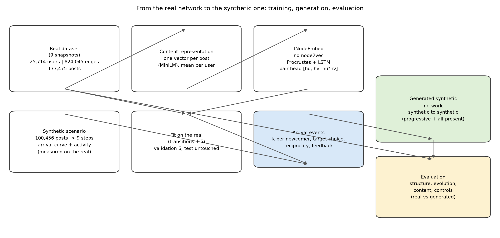
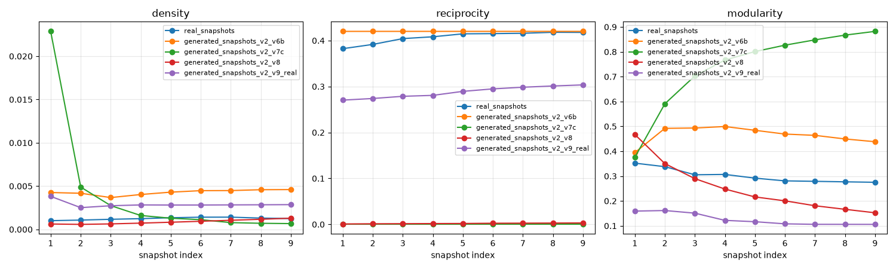
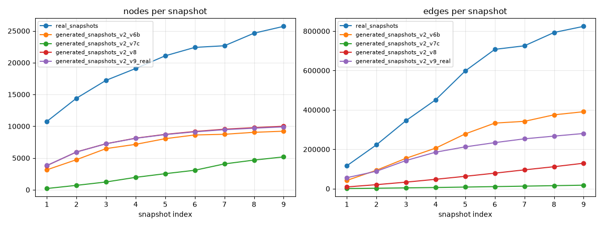
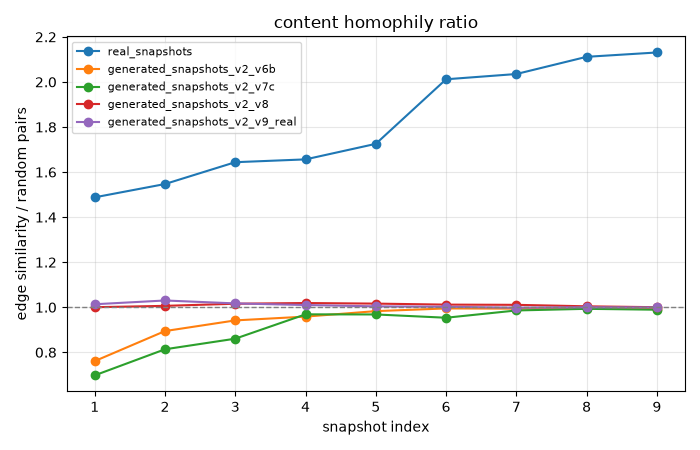
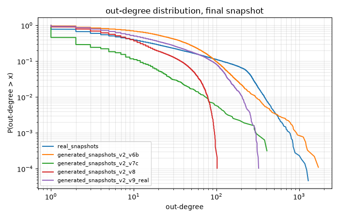
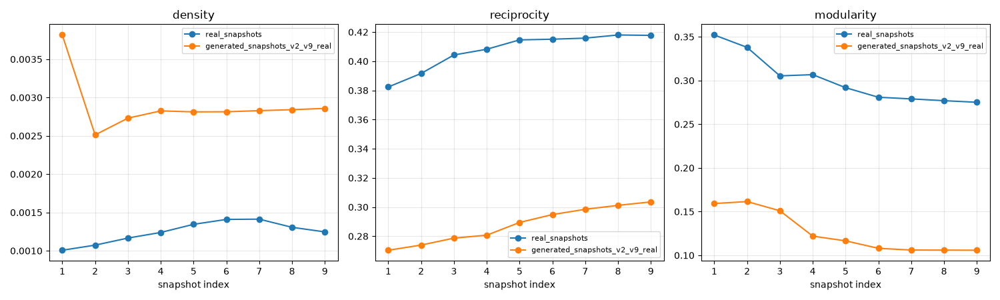
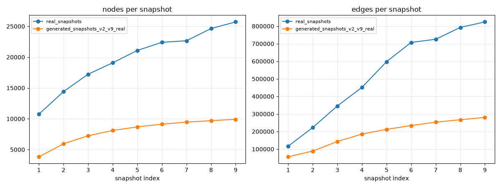
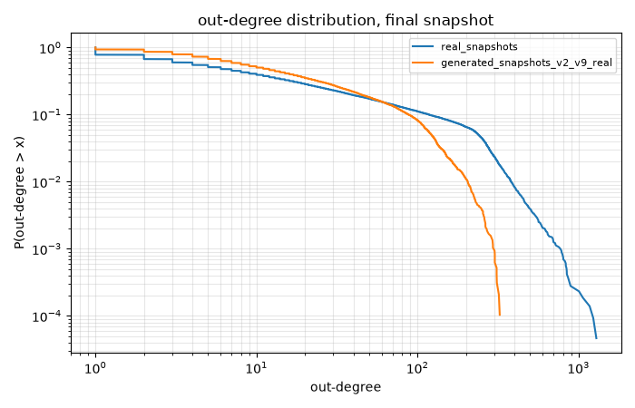
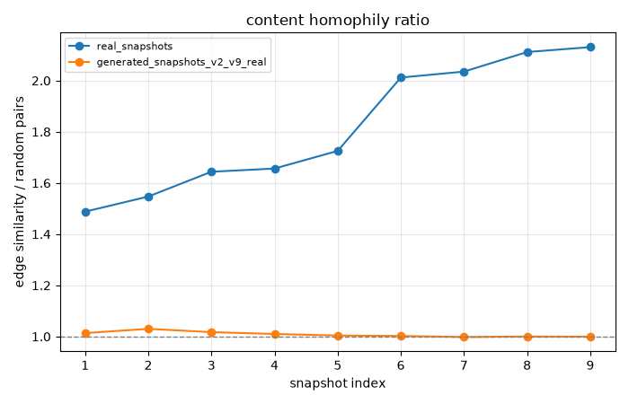
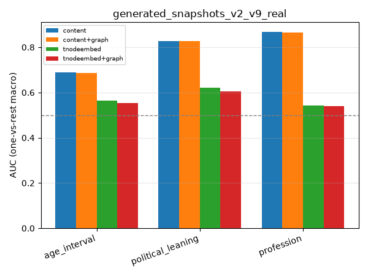

# From Post Text to User Network: Generating a Temporal Social Network by Transferring tNodeEmbed

**Angelantonio Fedele Murolo**

*Affiliation: none.*

---

## Abstract

Building the link structure of a population for which only the text it produces is available — with no observed links and no dates — requires learning the edge-formation mechanism from a different network and applying it by inference. This work studies the problem on two datasets: a real social network with 25,714 users, 824,045 directed edges and 173,475 posts spread over 9 snapshots (2022 – July 2025), and a synthetic dataset of 10,002 users with 100,456 posts, with no edges and no dates, which we partition into 9 time steps. The only information shared by the two datasets is the text of the posts. The temporal model is tNodeEmbed in its node2vec-free variant, initialised with content representations: per-snapshot representations, a chain of Procrustes alignments and an LSTM yield one embedding per user, and a pairwise head estimates the probability of a link. Because the restriction of the original evaluation protocol admits no test edge on the real network, evaluation uses the whole transition with matched and random negatives. From the learned coefficients we derive two generators fitted on the real data, both by sampling with feedback and with no imposed counts: a pairwise model and an **arrival-event** model, in which the unit is the entering user. The arrival-event model reproduces the real network within the right order of magnitude for reciprocity (0.304 vs 0.418), mean degree (28.30 vs 32.05), maximum degree (324 vs 1,290), transitivity (0.0209 vs 0.0337), clustering (0.043 vs 0.080) and diameter (6 vs 6), while remaining somewhat "flatter" than the real one (gaps of 0.25–0.88×), with a residual that the measurement attributes to the **shape** of the tail and to cohesion, not to the hubs: the maximum degree is at **97%** of what the scaling law estimated on the real network (exponent 1.445 over its nine snapshots) predicts at 10,000 users, and the comparison at matched size shows a steeper tail (−3.33 vs −1.69). A control with authentic text, text permuted across users and no text produces indistinguishable networks, both in the pairwise model and in the arrival-event model: **content does not decide who connects to whom**. Finally, the content homophily of the real network (2.13) is largely structure: against non-edges matched by degree it drops to 1.51 and to 1.29 with degree within ±10%. Negative results — content, encoder fine-tuning, trainable node features — are reported as results.

**Keywords:** temporal networks; node embedding; graph generation; homophily; transfer across domains; tNodeEmbed.

---

## 1. Introduction

Many questions about a social system require its interaction network, yet the available data often contain only the text that people produce: no observed links, no dates. When a second dataset holds the network but different text, a precise possibility opens up — **learn the edge-formation mechanism on the dataset that has the network and apply it, by inference, to the dataset that has none** — provided a channel of information is found that is present in both. This work addresses exactly that problem: given a corpus of posts from 10,002 users with no edges at all, build their social network and study its structure and evolution over time, using the text of the posts as the only information shared with the reference dataset.

The problem has three difficulties. The first is **the initialisation of never-seen nodes**: classical network-embedding methods such as node2vec cannot represent a user who has no links yet, whereas in the real network we study every new edge involves at least one entering user. The second is **transfer across populations of different size**: the dataset that carries the structure has 25,714 users, the one to be populated 10,002, so degree-related quantities must be expressed in relative form. The third is **evaluation**: in the dataset without edges there are no true links to predict, and a generative network model is not judged by a ranking measure.

The contribution is fourfold. (i) We adapt **tNodeEmbed** to our setting by removing node2vec and using post-content representations as the starting point: this is a possibility foreseen by the method itself, which admits any static embedding as initialisation. (ii) From the coefficients learned on the real dataset we derive **two fitted generators**, both by sampling with feedback and with no imposed counts: a **pairwise** model and an **arrival-event** model, in which the unit is not the pair but the entry of a user, who brings a group of edges with them. (iii) We set up a **controlled evaluation** based on network statistics and distributions, on the content control with authentic text, text permuted across users and no text, and on the decomposition of homophily with degree controls. (iv) We report negative results as results: content does not move the network, and encoder fine-tuning and trainable node features make things worse.

The summary of the results is as follows. The pairwise model reproduces the density of the real network (0.00129 vs 0.00125) and a mean degree 2–2.5 times from the real one, but remains far on reciprocity, triangles and the degree tail. The arrival-event model closes that gap: reciprocity 0.304 (real 0.418), mean degree 28.30 (real 32.05), maximum degree 324 (real 1,290), transitivity 0.0209 (real 0.0337), clustering 0.043 (real 0.080), diameter 6 as in the real network. The residual gaps are contained and all of the same sign, and have a single cause: the preference for the most connected nodes is underestimated when transferring across networks of different size. On the content side the results are sharp and partly counter-intuitive: text knows the user (from content alone, political leaning is predicted with AUC 0.827, profession with 0.867, age band with 0.690) but **not their links**; the content homophily of the real network, 2.13, is largely network position rather than a choice of similarity.

---

## 2. Related Work

**Node embeddings on temporal graphs.** tNodeEmbed (Singer, Guy and Radinsky, IJCAI 2019) is the reference of this work: it builds one representation per snapshot, aligns the representations of consecutive snapshots and learns their evolution with a recurrent network, using a pairwise loss for the link-prediction task. The general setting of node embedding is that of node2vec (Grover and Leskovec, KDD 2016), which tNodeEmbed uses as a static initialisation; because node2vec requires observed links, it cannot be applied to never-seen users. The literature offers other families of temporal models: temporal walks on continuous-time networks (Nguyen et al., WWW 2018), self-attention over neighbourhoods and time (Sankar et al., WSDM 2020), graph convolutional networks whose parameters evolve over time (Pareja et al., AAAI 2020), recurrent architectures over transitions (Goyal et al., *Knowledge-Based Systems* 2020), and the triadic-closure process as an explicit mechanism (Zhou et al., AAAI 2018). The picture is surveyed by Kazemi et al. (*JMLR* 2020). Unlike these works, our problem is not predicting future edges in a known network, but **populating with edges a network in which no link is observed**, by transferring parameters learned elsewhere.

**Graph generation.** Classical models — Barabási–Albert (1999) for preferential attachment, Watts–Strogatz (1998) for the small world, Kronecker graphs (Leskovec et al., *JMLR* 2010) for recursive structure — generate realistic topologies but are not fitted to the mechanism of a specific dataset and use no content. Recent neural generative models, GraphRNN (You et al., ICML 2018) and NetGAN (Bojchevski et al., ICML 2018), learn to reproduce graph distributions and are evaluated by comparing statistics and distributions, which is the same evaluation principle we adopt; they are not, however, designed to transfer a structure from one population to another that has no edges. The evolution laws of real graphs (densification and shrinking diameters; Leskovec, Kleinberg and Faloutsos, KDD 2005) provide the empirical references against which we read the growth of our networks.

**Content representation.** The text representations we use belong to the family of sentence encoders trained for similarity (Sentence-BERT; Reimers and Gurevych, EMNLP 2019). The choice among them is guided by a benchmark independent of our task (MTEB; Muennighoff et al., EACL 2023) and by the availability of compact models (BGE; Xiao et al., SIGIR 2024).

**Network properties and measures.** Homophily (McPherson, Smith-Lovin and Cook, 2001) and triadic closure (Granovetter, 1973) are the phenomena we measure; community structure is identified with the Louvain algorithm (Blondel et al., 2008). The recurrent cell that aggregates the temporal sequence is the LSTM (Hochreiter and Schmidhuber, 1997) and the alignment between coordinate systems is generalised Procrustes analysis (Gower, 1975).

**The gap we occupy.** None of these works addresses the combination that interests us: learning the edge-formation mechanism from a real network **and applying it by generation to a population that has only text**, while showing with explicit controls how much of the result comes from content and how much from structure.

---

## 3. Data

The two datasets were **provided for the project by the doctoral student who supervised it**. The first, which we call **real**, contains users, their posts and the links between them, spread over **9 snapshots** from January 2022 to July 2025: 25,714 users, 824,045 **directed** edges, 173,475 cumulative posts (154,580 counted per period). The split of the periods is declared: 6 training snapshots, 1 validation, 2 test. For each user, the real dataset contains **only post-level fields** (the text, the language, counts of reactions and replies, the timestamp): **there are no profile attributes**. The second dataset, which we call **synthetic**, contains 10,002 users (10,000 nominal) with **100,456 usable posts** (out of 100,474 rows, 18 discarded on reading because their field count differed from the header), **no edges and no dates**, plus 11 user profile attributes (including political leaning, profession and age band) which do not exist in the real dataset.

Because the model is trained on the real dataset and applied to the synthetic one, only what exists on both sides can enter as a feature: the **only shared column**, beyond identifiers, is the **text of the posts** (`content`). The synthetic attributes are never used as input and serve **only in evaluation**. The real dataset is not modified in any way: the synthetic network is a new artefact, and its links are exclusively **synthetic-to-synthetic**.

**Table 1 — The two datasets.**

| | real | synthetic |
|---|---|---|
| users | 25,714 | 10,002 (10,000 nominal) |
| posts | 173,475 cumulative / 154,580 per period | 100,456 usable |
| edges (directed) | 824,045 | none |
| time | 9 snapshots, 2022 → 2025-07; split 6/1/2 | none: 4 batches in random order |
| information per user | only the post text | 11 profile attributes + text |
| shared column | **`content`** | **`content`** |

*Source: `results/variant_summary.csv` (row `real_snapshots`, nodes and edges of the final snapshot), `results/encoder_comparison.csv` and `results/structure_real_snapshots.csv`.*

**The time convention in the synthetic data.** The synthetic dataset has no dates; the only available order is the dense post identifier, which we assume to reflect the generation order. We partition it into **9 steps**, equal to the number of real snapshots, using two rules measured on the real data. First, the **arrival curve**, i.e. the share of users entering at each step when users are ordered by their first post: **0.418 · 0.142 · 0.110 · 0.072 · 0.078 · 0.051 · 0.010 · 0.077 · 0.042**. Second, the **activity shape**, i.e. when a user writes: each user's posts are distributed over the steps of that user's lifetime by sampling the real distribution of posts per active user per period (**mean 3.7, median 2, p90 9**), with bursts placed **at random**, so that both full and silent periods appear. We do **not** use the real aggregate posts-per-snapshot curve, because the real snapshots have heterogeneous lengths (from one year to a few days) and those counts measure "activity × window length". What remains a declared choice on our side is the arrival order (inferred from the identifiers) and the order within each step.

*Source: arrival curve and activity distribution measured on the real data by the partition builder (`src/build_synthetic_snapshots.py`); the posts-per-active-user distribution is in `results/_activity_check.txt`.*

---

## 4. Method

**Figure 1** — Pipeline schematic. The temporal model is trained on the real dataset; the synthetic dataset is partitioned into 9 steps using the arrival curve and activity shape measured on the real data; the network is generated step by step by sampling with feedback. File: `results/figures/paper_pipeline.png`.

### 4.1 Content representation

The only textual input is the text of the posts. Each post is encoded **individually** by a sentence encoder, and a user's vectors are **averaged** into one representation per user and snapshot. We chose the encoder with a comparison protocol rather than a priori: the whole temporal pipeline is trained on the real data with each encoder, and the AUCs on the validation and test transitions are compared. The deciding column is the one with **matched negatives** (see §4.2).

**Table 2 — Encoder selection on the real dataset** (AUC on validation / test1 / test2; mean = val+test; period text).

| encoder | AUC, matched negatives (val / test1 / test2) | mean | AUC, random negatives | edges satisfying the original protocol restriction |
|---|---|---|---|---|
| tf-idf + SVD | 0.489 / 0.521 / 0.505 | 0.505 | 0.986 / 0.931 / 0.941 | 0 / 0 / 0 |
| **all-MiniLM-L6-v2** | 0.571 / 0.521 / 0.510 | **0.534** | 0.995 / 0.954 / 0.961 | 0 / 0 / 0 |
| BGE-small | 0.541 / 0.517 / 0.519 | 0.526 | 0.996 / 0.958 / 0.967 | 0 / 0 / 0 |
| GTE-small | 0.529 / 0.514 / 0.507 | 0.516 | 0.996 / 0.956 / 0.963 | 0 / 0 / 0 |
| BGE-base | 0.540 / 0.517 / 0.535 | 0.530 | 0.996 / 0.960 / 0.968 | 0 / 0 / 0 |
| GTE-base | 0.543 / 0.523 / 0.531 | 0.532 | 0.996 / 0.959 / 0.969 | 0 / 0 / 0 |

*Source: `results/encoder_comparison.csv`. The last column is the number of test edges admitted by the original protocol restriction in each window.*

Encoding **per post** improves every encoder over concatenating a user's posts into a single string, which the encoder truncated at its token limit: the mean val+test rises from 0.534 to **0.549** for MiniLM, from 0.530 to **0.540** for BGE-base, from 0.505 to **0.524** for tf-idf. The pipeline adopts **all-MiniLM-L6-v2** with per-post encoding and averaged vectors; the encoder is trained only on training content.

*Source: `results/encoder_comparison.csv`, rows `*|mean_of_posts|frozen`.*

### 4.2 Temporal model

The temporal model is **tNodeEmbed without node2vec**. For each snapshot `t` we have a users × dimension matrix built from content (§4.1); a **chain of orthogonal Procrustes alignments** between consecutive snapshots brings the representations into a common coordinate system, estimated on the nodes present in both snapshots and applied to all, including new ones; an **LSTM** reads the sequence of the 9 steps of each user and compresses it into a temporal embedding; a **pairwise head**, fed by `[h_u, h_v, h_u * h_v]` (the embedding of the first user, that of the second and their element-wise product), produces the link score, optimised with binary cross-entropy on the training transitions and with early stopping on validation. The test set is not touched until evaluation.

Removing node2vec is not an omission but a data-driven choice: node2vec initialises itself by observing links, so it cannot represent a user appearing for the first time, and on this dataset **every new edge involves an entering counterpart**. Applying the **restriction of the original evaluation protocol** (test limited to pairs between already-observed users) yields **0 test edges in every transition** (Table 2, last column): the restriction, correct in general, is empty here. Evaluation therefore uses the **whole transition** (all new edges of the period), with two kinds of negatives: **random** and **matched**, where each true pair is coupled with a false pair sharing the same first user and a destination with a similar arrival history and degree. The matched mode is the deciding column, because it prevents the model from "cheating" by recognising the new user from the sequence alone.

### 4.3 Network generation

A network does not automatically emerge from the temporal model's scores: decisions are needed on which pairs become edges. We make them by **fitting the mechanism on the real dataset** and applying it by generation to the synthetic one, with two families.

**Pairwise model (V8).** A logistic regression (with prior correction) is estimated on the real data to assign each candidate pair the probability of becoming an edge. The variables are the temporal model's content score, the **relative degree** (percentile in the population, in a form transferable across populations of different size) of source and destination, whether either endpoint is **new**, the existence of the **reverse edge**, the number of **common neighbours**, whether either endpoint wrote in the period, the **recency** (steps since the last received edge) and the temporal step. Generation proceeds **step by step with feedback**: at each step the variables are recomputed on the state of the freshly generated network and each pair becomes an edge with its **own** probability; **no threshold and no count is imposed**, so volume, degrees and hubs emerge from sampling. Which pairs are candidates is not our decision: on the real dataset **at least one endpoint of every new edge wrote in the period in 100%** of cases (a fact the data impose), whereas the *source* alone is active in **68–81%** and therefore remains a variable the model weights by itself.

*Source: `results/source_activity.csv`, `results/v8_coefficients.csv`, `results/v8_report.csv`.*

**Arrival-event model (V9).** The pairwise model leaves three properties far away: reciprocity, triangles and the degree tail. Looking at the real network, these three things are **a single phenomenon**: when a new user enters, they do not bring one edge but **a group of edges**. On the real data an arrival event is estimated to carry on average **35–111 edges** depending on the transition (median 6–32), with a maximum of **1,202**, i.e. the same order as the real maximum degree: the hub is born from a *single* arrival, not from the sum of independent decisions. About **40%** of the pairs in the event are reciprocated within the event itself. V9 estimates three things on the real data — how many edges an arrival carries, where the targets go (degree, novelty of the counterpart, activity, content, co-occurrence) and the share of reciprocated pairs — and generates **arrival by arrival**, with the state updated at each step and `k` rescaled linearly on the population (from 25,714 to 10,000 users). Content is one of the choice variables, exactly as in V8.

*Source: the arrival quantities (mean, median, maximum, outgoing share) are in `results/arrival_events.csv`; the number of edges per event (k) and the share of reciprocated pairs used in generation are in the log `results/_v9_run.txt`; the coefficients and the statistics of the generated network are in `results/v9_coefficients.csv` and `results/v9_report.csv`.*

### 4.4 Scenario construction

The synthetic scenario (when each user exists, how much they write at each step) is described in §3: the arrival curve and the activity shape come from the real data, while the arrival order within a step is a declared assumption of ours. The scenario matters because in the real data **92%** of new edges involve an entering user (49% new → old and 43% old → new); we nevertheless treated it as a control variable, generating the same network on different partitions. The partition used for all main comparisons is `generated_snapshots_v2` (all users present from the first step, activity from the real data).

*Source: `results/accretion_real_snapshots.csv`.*

### 4.5 Evaluation protocol and hierarchy of metrics

A **generated network is not evaluated with an AUC**: in the synthetic dataset there are no true edges to predict, so a ranking measure has no object. We adopt an explicit hierarchy.

1. **Primary — per-snapshot network statistics and distributions**, compared with the real network on the final snapshot: degree distribution (mean, maximum, CCDF), reciprocity, transitivity and average clustering, modularity (Louvain), diameter, growth composition.
2. **Secondary — content**, with the nature of the link: content homophily with degree controls, and the A/B/C control (authentic text, text permuted across users, no text).
3. **Diagnostic, on the real data only** — AUC and average precision with matched and random negatives, used to choose the encoder and to fit the model. The AUC ablation on the real data is **saturated** (0.9818 → 0.9816) and by itself does not measure the contribution of text: the evidence is the comparison between networks (point 2).
4. **Not valid** — AUC as a quality measure of a generated network.

---

## 5. Results

### 5.1 Comparing the generation families

Before the central comparison we compare the generation families. The table follows their historical order: from rules with hand-decided counts, to a threshold calibrated on real statistics, to a content-only model with a threshold, up to the two **fitted and sampled** generators.

**Table 3 — Final snapshot: generation families against the real network.**

| network | nodes | edges | density | mean degree | max degree | reciprocity | modularity | transitivity | clustering | homophily |
|---|---|---|---|---|---|---|---|---|---|---|
| **real** | 25,714 | 824,045 | 0.00125 | 32.05 | 1,290 | 0.418 | 0.275 | 0.0337 | 0.080 | 2.13 |
| reference (content only) | 10,000 | 107,511 | 0.00108 | 10.75 | 28 | 0.0011 | 0.167 | 0.506 | 0.747 | 0.996 |
| v5 (hand rule + reciprocity) | 10,000 | 427,056 | 0.00427 | 42.71 | 998 | 0.495 | 0.098 | 0.0111 | 0.0318 | 1.002 |
| v6a (threshold calibrated on degree) | 10,000 | 64,422 | 0.00064 | 6.44 | 1,885 | 0.420 | 0.661 | 0.0001 | 0.0110 | 0.994 |
| v7c (inference with a global threshold) | 10,000 | 57,558 | 0.00058 | 5.76 | 920 | 0.183 | 0.737 | 0.0933 | 0.0587 | 0.998 |
| **V8 — pairwise model** | 10,000 | 129,321 | 0.00129 | 12.93 | 102 | 0.0031 | 0.152 | 0.0027 | 0.0053 | 1.000 |
| **V9 — arrival events** | 9,904 | 280,298 | 0.00286 | 28.30 | 324 | 0.304 | 0.106 | 0.0209 | 0.0433 | 0.999 |

*Source: `results/variant_summary.csv`.*

The families differ in **how the count arises**. Hand rules (v1–v5) decide the number of edges: the version with added reciprocity (v5) hits the real reciprocity (0.495) by construction, and its transitivity stays an order of magnitude below the real one. The calibrated family (v6a) imposes a real statistic — here the final degree — and obtains a very high maximum degree (1,885) with zero transitivity (0.0001). The content-only family with a threshold (v7c) stays at one fifth of the real degree. Only the two **fitted and sampled** families produce a density close to the real one without imposing anything, and only V9 brings the relational properties within the right order of magnitude. The reading is clear: **imposing** a statistic (v6) or applying a content-only model (v7) is not enough; **learning the mechanism** and sampling it is.

The quantitative reading, however, makes the comparison less comfortable than that. Over **seven comparable metrics V9 is the closest to the real network only on mean degree** (28.30 vs 32.05): the best density is V8's, transitivity and clustering are v6b's, reciprocity is v6a/v6b's (0.420, but **imposed** by construction) and maximum degree and modularity are v2's (`results/variant_scorecard.csv`). V9's advantage is **simultaneity**: it is the only one to get the degree scale, cohesion and the direction of the tail together **without imposing statistics on the networks**, which is why we adopt it. Measured on the **tail slope** — the CCDF of out-degree over the top decile, which the maximum alone cannot distinguish — the distance remains, but the comparison has to be made **at matched size**: the real network's first snapshot (10,755 users) has slope **−1.69**, so V9's tail (**−3.33**) is **steeper** — relatively less extreme hubs — while v2 −2.25 and v6b −2.09 cut it too little; and the maximum is not a defect, as the scaling law below shows. Finally, volume is not a direct term of comparison: edges are mean degree times the number of users, so V9's 280,298 edges over 9,904 users are worth about 317,000 at the real scale (10,000 users at the real mean degree), where V9 is the closest (0.88; V8 0.40, v2/v6b 1.29–1.32).

**Figure 2** — Structure of the generation families against the real network (density, reciprocity, modularity, degrees). File: `results/figures/families_structure.png`.

**Figure 3** — Growth of nodes and edges over time for the families. File: `results/figures/families_growth.png`.

**Figure 4** — Content homophily: real network against the families. File: `results/figures/families_homophily.png`.

**Figure 5** — Degree distribution tail (CCDF). File: `results/figures/families_degree_ccdf.png`.

### 5.2 The central comparison: real against V9

The arrival-event model is the most advanced result. The table reports the final snapshot.

**Table 4 — Final snapshot: real, V9 and V8.**

| network | edges | nodes | density | mean degree | max degree | reciprocity | modularity | transitivity | clustering | diameter | homophily |
|---|---|---|---|---|---|---|---|---|---|---|---|
| **real** | 824,045 | 25,714 | 0.00125 | 32.05 | 1,290 | 0.418 | 0.275 | 0.0337 | 0.080 | 6 | 2.13 |
| **V9** | 280,298 | 9,904 | 0.00286 | 28.30 | 324 | 0.304 | 0.106 | 0.0209 | 0.043 | 6 | 0.999 |
| V8 | 129,321 | 10,000 | 0.00129 | 12.93 | 102 | 0.0031 | 0.152 | 0.0027 | 0.0053 | 9 | 1.000 |

*Source: `results/variant_summary.csv` (rows `real_snapshots`, `generated_snapshots_v2_v9_real`, `generated_snapshots_v2_v8`) and `results/structure_heavy_generated_snapshots_v2_v9_real.csv` for the diameter.*

V9 brings **within the right order of magnitude** four properties that the pairwise model got wrong: **reciprocity** (0.304 vs V8's 0.003; real 0.418), the **degree scale** (mean degree 28.30 vs 12.93), the **tail** (maximum degree 324 vs 102) and **cohesion** (transitivity 0.0209 vs 0.0027; clustering 0.043 vs 0.0053), with a **diameter** identical to the real one (6 vs 6; V8: 9). At the same time, modularity drops from 0.152 (V8) to 0.106, moving closer to the real value (0.275) than before.

**Figure 6** — Real against V9: density, reciprocity, modularity and degrees. File: `results/figures/paper_structure.png`.

**Figure 7** — Growth of nodes and edges over time. File: `results/figures/paper_growth.png`.

**Figure 8** — Degree distribution tail (CCDF): real against V9. File: `results/figures/paper_degree_ccdf.png`.

**What remains, and why.** The residual gaps are contained and **all of the same sign**: V9 is somewhat "flatter" than the real network (maximum degree 0.25×, modularity 0.38×, clustering 0.54×, transitivity 0.62×, reciprocity 0.73×, mean degree 0.88×). The common thread is **the preference for the most connected nodes**, which remains underestimated. The direct measurement is in the growth composition: the two endpoints of real edges have mean degree **436.9** against a mean of **64.4** over all nodes (ratio 6.8), whereas in V9 the pre-existing endpoint has mean degree **169.4** against **55.1** (ratio 3.1); the mean degree of the pre-existing endpoint therefore falls to about **0.39×** the real one.

**Table 5 — Composition of new edges (values pooled over all transitions).**

| | real | V9 |
|---|---|---|
| new → pre-existing | 48.9% | 50.4% |
| pre-existing → new | 43.0% | 37.2% |
| new → new | 8.1% | 12.4% |
| pre-existing → pre-existing | 0.0% | 0.0% |
| mean degree of the pre-existing endpoint (last step) | 436.9 | 169.4 |
| mean degree of all nodes (last step) | 64.4 | 55.1 |

*Source: `results/accretion_real_snapshots.csv` and `results/accretion_generated_snapshots_v2_v9_real.csv`.*

V9 reproduces the **shape** of accretion (no edge between two pre-existing users, which in the real data is exactly 0 out of 707,604 new edges) but not the **intensity** of the preference for hubs, and it slightly overestimates the share of edges between co-arriving users (12.4% vs 8.1%). This is **the single cause** of the gaps in Table 4: degree variables are expressed in percentiles in order to transfer the mechanism from 25,714 users to 10,000, and a percentile of a small network corresponds to a less extreme hub.

### 5.3 The content control

Content is the only information that distinguishes the 10,000 synthetic users from one another, so its role must be measured, not postulated. With the **same model fitted on the real data and the same scenario**, we generate three networks that differ only in the textual channel on the synthetic side: **A** authentic text, **B** text permuted across users (the same text profiles reassigned to other people, so the text statistics stay identical), **C** no text.

**Table 6 — A/B/C control.** *(a) pairwise model (V8); (b) arrival-event model (V9).*

*(a) V8*

| mode | edges | density | reciprocity | max degree | modularity | transitivity | homophily |
|---|---|---|---|---|---|---|---|
| A — authentic text | 128,831 | 0.001288 | 0.0031 | 107 | 0.154 | 0.00269 | 1.0009 |
| B — permuted text | 123,294 | 0.001233 | 0.0030 | 96 | 0.159 | 0.00253 | 0.9998 |
| C — no text | 124,560 | 0.001246 | 0.0029 | 106 | 0.156 | 0.00262 | 1.0004 |

*(b) V9*

| mode | edges | density | reciprocity | max degree | modularity | transitivity | homophily |
|---|---|---|---|---|---|---|---|
| A — authentic text | 280,298 | 0.002858 | 0.3035 | 324 | 0.106 | 0.0209 | 0.9994 |
| B — permuted text | 274,448 | 0.002803 | 0.3021 | 344 | 0.106 | 0.0207 | 1.0021 |
| C — no text | 280,292 | 0.002861 | 0.3037 | 326 | 0.105 | 0.0211 | 0.9993 |

*Source: `results/variant_summary.csv` (rows `generated_snapshots_v2_v8_{real,permuted,off}` and `generated_snapshots_v2_v9_{real,permuted,off}`).*

In both mechanisms the three networks are **indistinguishable** in their relational properties: volume varies by a few percentage points and **without order** (the network with permuted text is closer to the one without text than to the one with authentic text), and reciprocity, transitivity, degree tail and modularity coincide within the noise between trainings. The only visible effect of text is minimal: in V8 homophily goes from 1.0004 (no text) to 1.0009 (authentic text), about 0.08% of the real gap (2.13). **Content does not move the network.**

This result is consistent with the learned weights. In the pairwise model, on standardised variables, the content score weighs **+0.14** against **+3.28** for the variable "the source is new" and **+2.88 / +3.05** for the degree percentiles. In the arrival-event model content weighs **+0.05** against **+1.21** for the novelty of the counterpart and **+1.02 / +0.91** for degree and percentile. The model discriminates well (AUC on the validation transition: 0.9818 for V8, 0.9181 for V9), but it does so **with structure**: *who enters* and *how connected they are*, not *what they write*.

*Source: `results/v8_coefficients.csv`, `results/v9_coefficients.csv`, `results/v8_report.csv`, `results/v9_report.csv`.*

### 5.4 Decomposing homophily

The number that seemed to contradict §5.3 is the content homophily of the real network: **2.13** on the final snapshot, i.e. the two endpoints of an edge are more than twice as similar as two randomly drawn users. The standard measure, however, compares every edge with two **arbitrary** users, whereas the endpoints of edges are not arbitrary users: in the real data the pre-existing endpoint has mean degree **436.9** against **64.4**, and the lexical similarity between two users **grows with degree** (0.079 in the lowest degree decile, 0.291 in the highest). If the comparison is made against **non-edges in the same position**, homophily changes face.

**Table 7 — Content homophily of the real network against structural controls (final snapshot).**

| comparison | ratio | AUC edges vs control |
|---|---|---|
| **random** pairs (standard measure) | 2.133 | 0.702 |
| non-edges with the **same degree** (broad classes) | 1.511 | 0.610 |
| non-edges with degree within **±10%** | 1.290 | 0.575 |
| non-edges with similar degree and **arrival** | 1.511 | 0.610 |
| non-edges with the same **text volume** | 1.554 | 0.648 |
| non-edges with similar degree and **text volume** | 1.367 | 0.585 |
| — internal similarity by degree decile: 1st decile 0.079 → 10th decile 0.291 | | |

*Source: `results/homophily_control.csv`. The tightest controls (degree within ±10%) destabilise the sample (737,101 pairs), so 1.29 should be read as a lower bound.*

More than half of the gap disappears as soon as comparable users are compared: **the 2.13 is largely network position**, not a choice of similarity. A **small lexical residual** remains (ratio 1.29; AUC 0.58), which lives in the lexical profiles used for this measure and not in the generator's channel (per-post, where the signal is null): the real 2.13 and the 1.00 of the generated networks **do not measure the same thing**, and this is the reason for the apparent contradiction.

**Figure 9** — Content homophily: real against V9 and the controls. File: `results/figures/paper_homophily.png`.

### 5.5 Profiles

In the synthetic dataset the user attributes are known labels, so we can ask whether the text knows *who* a user is. We train a classifier on 80% of the users (stratified split with a fixed seed) and measure the macro AUC on the remaining 20%, comparing four representations.

**Table 8 — Predicting profile attributes (macro AUC, final snapshot).**

| label (classes) | content only | content + graph | temporal embedding | embedding + graph |
|---|---|---|---|---|
| political leaning (7) | **0.827** | 0.828 | 0.622 | 0.605 |
| profession (41) | **0.867** | 0.866 | 0.543 | 0.541 |
| age band (8) | **0.690** | 0.687 | 0.564 | 0.555 |

*Source: `results/profiles_generated_snapshots_v2_v9_real.csv`.*

**Content knows the user**, and adding the network changes nothing; the temporal embeddings, trained to predict *links*, lose the profile. This is **the mirror image of §5.3**: *who* a user is lies in the text, *whom they connect to* lies in the structure. The link, in fact, depends on state variables — the user's entry (their age within the observed window) and their degree (§5.3) — which text does not contain.

**Figure 10** — Profile classification performance. File: `results/figures/paper_profiles.png`.

### 5.6 Negative results

We present as results also the paths that did not work, because they delimit the contribution.

- **Content does not carry the link.** The A/B/C control (§5.3) is indistinguishable in both generators; the AUC with matched negatives on the real data is around chance; the learned weight of content is an order of magnitude below that of structure.
- **Encoder fine-tuning fails.** Trained with a contrastive loss on real edges and with matched and temporal negatives, it worsens **the validation too**, besides both test windows: the val+test mean drops from 0.534 to **0.519** for MiniLM and from 0.530 to **0.523** for BGE-base. The supervision is too weak and the encoder adapts to the period it sees.
- **Trainable node features make things worse.** Making the content-initialised projection trainable lowers the val+test mean from 0.534 to **0.512** on the **concatenated** encoding (the pipeline we adopt uses the per-post encoding, §4.1): added capacity leads to overfitting.
- **A "mixed" negative sampling makes the network worse.** Replacing uniform negatives with a 30/30/40 mixture (pairs reversed with respect to real edges, candidates from the most connected decile, uniform), everything else unchanged: transitivity 0.0115 vs 0.0209, clustering 0.0305 vs 0.043, edges between users arriving in the same step 18.4% vs 12.4% (real 8.1%), degree of the already-present endpoint 104 vs 169 (real 437), reciprocity 0.300 vs 0.3035. The learned weights move a lot — novelty of the counterpart +0.61 vs +1.22, logarithmic degree −0.21 vs +1.02 — but reciprocity **does not move**: in V9 it is produced by the table of reciprocated pairs, not by the classifier. The documented uniform configuration therefore remains the default.
- **The AUC ablation is saturated and useless.** Removing the content score from the model moves the AUC on the real data from 0.9818 to 0.9816: a measure this high does not separate the two cases, which is why the evidence of §5.3 is the comparison between networks.

*Source: `results/encoder_comparison.csv`, `results/finetune_report.csv`, `results/v9_strat_coefficients.csv`.*

---

## 6. Discussion

**What structure explains, and what content does not.** The measurements converge on a single reading. The mechanism that generates links in this system is **relational and sequential**: edges arise when a user enters, they point towards users more connected than average, they concentrate in a few large arrivals and are partly reciprocated immediately. The learned weights (novelty and degree dominant, content an order of magnitude smaller) and the A/B/C controls say the same thing. Text, by contrast, contains clearly *who* a user is — content predicts profile attributes with AUC up to 0.867 — but **not** *whom they connect to*: the channel that explains identity does not explain the relation. The second, less intuitive result is that the content homophily of the real network does not contradict this reading: 2.13 is largely network position (degree), and the residual attributable to similarity is small (1.29) and does not live in the channel used by the generator.

**The limit of transfer across networks of different size, measured.** We believed it was the single cause of V9's residual gaps, and the measurement refuted that. To transfer a degree preference from 25,714 users to 10,000 we express degree as **percentiles**, and the mean degree of the already-present endpoint comes out at 169 against 437: it looked like an underestimation, but it is **exactly the ratio between the populations** (0.385). The same holds for the maximum: the maximum degree grows with the population according to a law estimated **on the real network itself** (its nine snapshots: exponent **1.445**, R² 0.986), and at 10,000 users that law predicts **~339**; V9 reaches **328**, that is **97%**, while the variants that "win" on the maximum exceed it by 2.9 (v2) and 5.6 times (v6b). What the transfer does **not** reproduce is the **shape** of the tail — at matched size the top-decile slope is −3.33 against −1.69 for the real network, so V9's hubs are relatively less extreme — and the **cohesion**, where the gap remains clearest (transitivity 0.0209 vs 0.0337, clustering 0.043 vs 0.080). The volume rescaling is also a choice of target rather than an error: `--exponent 1` makes the synthetic network carry the real's mature density, while the alternative dictated by the real's own law (1.79) matches the density but halves transitivity (0.00998) and lowers the maximum to 0.48 of the prediction.

**Threats to validity.** *Construct validity.* The network statistics we use are proxies: modularity depends on the chosen community algorithm, and the standard homophily measure is confounded by degree, as shown in §5.4. This is why we always pair the statistics with controls (degree, arrival, text volume). *Internal validity.* Two assumptions remain ours: the arrival order in the synthetic data (inferred from the identifiers) and the order within a step; we turned them into control variables with two partitions, but they cannot be verified. Comparing them shows that this choice matters little: between the "all present from the first step" partition and the progressive-entry one using the real arrival curve, the relative distance from the real network over eight metrics is **3.79 vs 4.39** (3.26 vs 3.29 excluding the share of edges between co-arriving users), with the progressive one better on reciprocity (0.3224 vs 0.3035) and the official one better on volume, mean degree, maximum degree and cohesion. The generated network is therefore robust with respect to this assumption. Moreover, transfer across populations of different size is an extrapolation, which we mitigated with relative variables. Finally, the learned coefficients fluctuate slightly between trainings (content in a range of +0.11 ÷ +0.26 depending on the round), so they should be read as estimates. *External validity.* The result concerns **one** real dataset and **one** synthetic dataset, both provided for the project; we do not know whether the learned mechanism generalises to other platforms or domains, and we have no second dataset with edges with which to verify it. *Conclusion validity.* The main tables come from a **single final execution** of the models with the same analyses, so they are comparable with one another but carry no confidence intervals; the fine-grained content controls are unstable across steps.

---

## 7. Conclusions

We built the link structure of a population for which only text is observed, learning the edge-formation mechanism from a real network and applying it by inference, never coupling the two datasets. The arrival-event model reproduces the structure of the real network within the right order of magnitude for reciprocity (0.304 vs 0.418), mean degree (28.30 vs 32.05), maximum degree (324 vs 1,290), transitivity (0.0209 vs 0.0337), clustering (0.043 vs 0.080) and diameter (6 vs 6), and beats on all these properties the pairwise model that precedes it. Against the threshold and imposed-count families the advantage is one of **simultaneity**, not of supremacy on every single metric: over seven comparable metrics V9 is the closest to the real network only on mean degree (`results/variant_scorecard.csv`), and it is the only one to get degree scale, cohesion and the direction of the tail together **without imposing statistics on the networks**; its tail remains **steeper** than the real one at matched size (−3.33 vs −1.69). It remains somewhat "flatter" than the real network, but not because of an underestimation of the hubs — which at matched size sits at **97%** of what the real's scaling law predicts — rather because of the **shape** of the tail and the **cohesion**: these are the two points on which the work can continue.

On content the work produces two controlled results. First: **content does not decide who connects to whom** — with authentic text, text permuted across users and no text, the networks are indistinguishable, in both generators. Second: the number that seemed to say the opposite, the 2.13 homophily of the real network, is **largely network position**, and drops to 1.51 and 1.29 under degree controls. Text knows the user (profile attributes with AUC up to 0.867) but not their links, which depend on the user's entry into the observed window and on their degree.

The directions that remain open are precise: a form of transfer that preserves the **degree tail** and not only relative position; the **dependence among the targets chosen within the same arrival event**, which would close the triadic part; and a content representation that acts **at the level of the pair** rather than the individual user, the only way in which text could still enter edge formation.

---

## Reproducibility and data availability

All figures in this article come from files in `results/` and from a **single final execution** of the models, with fixed seeds and with the same analyses applied to the real network and to every generated network. The generators iterate edges in **sorted order**, because the iteration order of sets of strings is not fixed in Python: without this precaution the network volume could vary by about 2% between processes. Reproducibility, however, has a boundary that we measure and declare: the **generator** is deterministic — re-running the documented command yields the **same** 8,293 arrival events, the same number of edges per event (33.799), the same share of reciprocated pairs (0.4074) and the same reciprocity (0.3035) — while the **training** is not bit-reproducible, because the network weights vary in the third decimal place between processes and the volume moves from 280,298 to **280,299** edges, that is one edge in 280 thousand (`results/v9_check_coefficients.csv` against `results/v9_coefficients.csv`). This is why we present every figure as coming from a single execution. The encoder selection, the fitting of the two generators and the structural, content, growth and profile analyses are described in full in the source code; the numeric artefacts are in `results/*.csv` and the figures in `results/figures/`. The real network was never modified; the generated networks are new artefacts.

The two datasets are not redistributed here. Because the datasets are not public, full reproducibility requires access to the same inputs; parameters, seeds and procedures are documented nonetheless, so that the method can be reapplied to equivalent data.

---

## References

1. Singer, U., Guy, I., Radinsky, K. (2019). *Node Embedding over Temporal Graphs.* In Proceedings of the 28th International Joint Conference on Artificial Intelligence (IJCAI), 4605–4612. arXiv:1903.08889.
2. Grover, A., Leskovec, J. (2016). *node2vec: Scalable Feature Learning for Networks.* In Proceedings of the 22nd ACM SIGKDD International Conference on Knowledge Discovery and Data Mining (KDD), 855–864. arXiv:1607.00653.
3. Nguyen, G. H., Lee, J. B., Rossi, R. A., Ahmed, N. K., Koh, E., Kim, S. (2018). *Continuous-Time Dynamic Network Embeddings.* In Companion Proceedings of the Web Conference (WWW), 969–976. doi:10.1145/3184558.3191526.
4. Sankar, A., Wu, Y., Gou, L., Zhang, W., Yang, H. (2020). *DySAT: Deep Neural Representation Learning on Dynamic Graphs via Self-Attention Networks.* In Proceedings of the 13th ACM International Conference on Web Search and Data Mining (WSDM), 519–527. arXiv:1812.09430.
5. Pareja, A., Domeniconi, G., Chen, J., Ma, T., Toyoda, T., Holzer, M., Karypis, G. (2020). *EvolveGCN: Evolving Graph Convolutional Networks for Dynamic Graphs.* In Proceedings of the AAAI Conference on Artificial Intelligence, 34(04), 5363–5370. arXiv:1902.10191.
6. Goyal, P., Chhetri, S. R., Canedo, A. (2020). *dyngraph2vec: Capturing network dynamics using dynamic graph representation learning.* Knowledge-Based Systems, 187, 104816. arXiv:1809.02657.
7. Kazemi, S. M., Goel, R., Jain, K., Kobyzev, I., Sethi, A., Forsyth, P., Poupart, P. (2020). *Representation Learning for Dynamic Graphs: A Survey.* Journal of Machine Learning Research, 21(70), 1–73.
8. Zhou, L., Yang, Y., Ren, X., Wu, F., Zhuang, Y. (2018). *Dynamic Network Embedding by Modeling Triadic Closure Process.* In Proceedings of the AAAI Conference on Artificial Intelligence, 32(1).
9. You, J., Ying, R., Ren, X., Hamilton, W. L., Leskovec, J. (2018). *GraphRNN: Generating Realistic Graphs with Deep Auto-regressive Models.* In Proceedings of the 35th International Conference on Machine Learning (ICML), PMLR 80, 5708–5717. arXiv:1802.08773.
10. Bojchevski, A., Shchur, O., Zügner, D., Günnemann, S. (2018). *NetGAN: Generating Graphs via Random Walks.* In Proceedings of the 35th International Conference on Machine Learning (ICML), PMLR 80, 610–619. arXiv:1803.00816.
11. Leskovec, J., Chakrabarti, D., Kleinberg, J., Faloutsos, C., Ghahramani, Z. (2010). *Kronecker Graphs: An Approach to Modeling Networks.* Journal of Machine Learning Research, 11(33), 985–1042.
12. Barabási, A.-L., Albert, R. (1999). *Emergence of Scaling in Random Networks.* Science, 286(5439), 509–512.
13. Watts, D. J., Strogatz, S. H. (1998). *Collective dynamics of 'small-world' networks.* Nature, 393, 440–442.
14. Leskovec, J., Kleinberg, J., Faloutsos, C. (2005). *Graphs over Time: Densification Laws, Shrinking Diameters and Possible Explanations.* In Proceedings of the 11th ACM SIGKDD International Conference on Knowledge Discovery in Data Mining (KDD), 177–187.
15. Reimers, N., Gurevych, I. (2019). *Sentence-BERT: Sentence Embeddings using Siamese BERT-Networks.* In Proceedings of EMNLP-IJCNLP, 3982–3992. arXiv:1908.10084.
16. Muennighoff, N., Tazi, N., Magne, L., Reimers, N. (2023). *MTEB: Massive Text Embedding Benchmark.* In Proceedings of the 17th Conference of the European Chapter of the Association for Computational Linguistics (EACL), 2014–2037. arXiv:2210.07316.
17. Xiao, S., Liu, Z., Zhang, P., Muennighoff, N. (2024). *C-Pack: Packed Resources for General Chinese Embeddings.* In Proceedings of the 47th International ACM SIGIR Conference on Research and Development in Information Retrieval (SIGIR), 641–649. arXiv:2309.07597.
18. Blondel, V. D., Guillaume, J.-L., Lambiotte, R., Lefebvre, E. (2008). *Fast unfolding of communities in large networks.* Journal of Statistical Mechanics: Theory and Experiment, 2008(10), P10008. arXiv:0803.0476.
19. Hochreiter, S., Schmidhuber, J. (1997). *Long Short-Term Memory.* Neural Computation, 9(8), 1735–1780.
20. Gower, J. C. (1975). *Generalized Procrustes Analysis.* Psychometrika, 40(1), 33–51.
21. McPherson, M., Smith-Lovin, L., Cook, J. M. (2001). *Birds of a Feather: Homophily in Social Networks.* Annual Review of Sociology, 27, 415–444.
22. Granovetter, M. S. (1973). *The Strength of Weak Ties.* American Journal of Sociology, 78(6), 1360–1380.
23. sentence-transformers. *all-MiniLM-L6-v2* (model card). Hugging Face. https://huggingface.co/sentence-transformers/all-MiniLM-L6-v2
